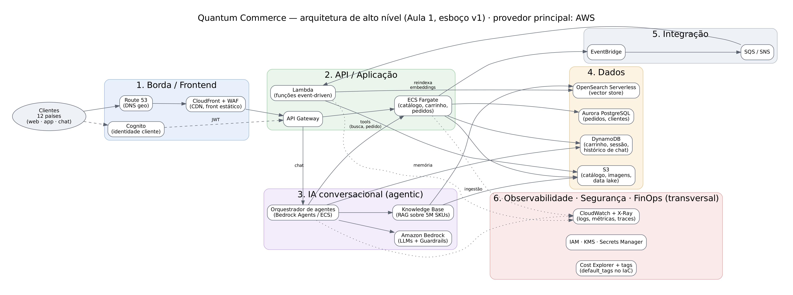

# Entrega Aula 01 — Grupo 01

**Disciplina:** Cloud & Cognitive Environments — FIAP MBA AI Engineering & Multi-Agents
**Turma:** 6AIER
**Data de entrega:** 13/11/2026

## Grupo

| # | Nome completo | GitHub | E-mail FIAP |
|---|---------------|--------|-------------|
| 1 | Julio Cesar da Silva | [@juliocs84](https://github.com/juliocs84) | rm379254@fiap.com.br |
| 2 | Eduardo Oliveira Santos Cunha | — | rm379314@fiap.com.br |

## Distribuição do trabalho

| Membro | Nível assumido | Item específico |
|--------|----------------|-----------------|
| Eduardo Oliveira Santos Cunha | 🟢 N1 | Exercícios 1.1, 1.2, 1.3 e 1.4 |
| Eduardo Oliveira Santos Cunha | 🟡 N2 | Exercício 2.3 — Estratégia de migração |
| Julio Cesar da Silva | 🟡 N2 | Exercícios 2.1 (arquitetura QC + diagrama) e 2.2 (comparativo de custos) |
| Julio Cesar da Silva | 🔴 N3 (bônus) | Exercícios 3.1 (Terraform), 3.2 (CloudFormation) e 3.3 (multi-cloud) — execução no CloudShell |
| Ambos | — | Reflexão coletiva e revisão cruzada |

---

## 🟢 Nível 1 — Respostas

### 1.1 — Mapeamento de modelos de serviço

| Serviço | Modelo | Justificativa |
|---------|--------|---------------|
| Gmail | SaaS | Aplicação pronta para o usuário final; o cliente não gerencia nada além da própria conta e dos dados. |
| Amazon EC2 | IaaS | A AWS entrega a VM; o cliente cuida de SO, patches, runtime e aplicação. |
| AWS Elastic Beanstalk (API) | PaaS | A AWS gerencia SO, runtime, balanceamento e escala; o time só publica o código. |
| AWS Lambda | FaaS | O código roda como função disparada por evento, sem servidor provisionado, com cobrança por invocação e duração. |
| Amazon RDS for PostgreSQL | PaaS (DBaaS) | A AWS opera o motor (patch, backup, failover); o cliente cuida de esquema, dados, índices e tuning de queries. |
| Salesforce CRM | SaaS | CRM completo consumido via navegador/API, só com configuração de negócio. |
| Google Kubernetes Engine (GKE) | CaaS (entre IaaS e PaaS) | O Google gerencia o control plane do Kubernetes; o cliente gerencia workloads, pods e, no modo Standard, os node pools. |
| Amazon S3 | PaaS (storage gerenciado; às vezes chamado STaaS) | Armazenamento de objetos sem servidor nem disco para gerenciar; o cliente cuida de dados, políticas e ciclo de vida. |
| Amazon Bedrock | SaaS / Model-as-a-Service | Modelos fundacionais consumidos via API, sem gerenciar GPUs, pesos ou infraestrutura de inferência. |

### 1.2 — Os 6 Rs na prática

| Cenário | R escolhido | Justificativa |
|---------|-------------|---------------|
| **A** — rastreamento de frotas, código de 2008, sem documentação, um único mantenedor, urgência | **Rehost (lift & shift)** | Mexer em código sem documentação e com um só conhecedor é o maior risco do cenário. Mover a VM como está (AWS Application Migration Service → EC2 com Auto Scaling) dá a elasticidade pedida rapidamente. A modernização fica para uma segunda fase, depois de documentar e reduzir a dependência dessa pessoa. |
| **B** — ERP de RH com < 5 usuários/mês, dados raramente consultados | **Retire** | O valor gerado não paga a migração. Arquivar os dados em storage frio (S3 Glacier, respeitando o prazo legal de guarda de dados trabalhistas) e desligar o sistema. As poucas consultas podem ir para o ERP corporativo ou para um relatório sobre o arquivo. |
| **C** — API de pagamentos monolítica → microserviços, K8s, event-driven | **Refactor / Re-architect** | A decisão de reescrever já foi tomada. É o R de maior esforço e risco, mas também de maior ganho (escala independente, deploy contínuo, resiliência). Em pagamentos, aplicar o padrão *strangler fig* para extrair serviços aos poucos. |
| **D** — CRM interno de 15 anos; SaaS cobre 90% por menor custo | **Repurchase (drop & shop)** | Troca para SaaS (ex.: Salesforce, HubSpot). Os 10% restantes viram customização ou integração na plataforma, ou um ajuste de processo. Some o custo de manter software que não é diferencial competitivo. |
| **E** — mainframe com dados de clientes que precisam ficar on-premises por exigência do Banco Central | **Retain** | A restrição regulatória decide. Manter on-premises e integrar com a nuvem de forma híbrida (Direct Connect, APIs, réplicas anonimizadas para analytics), reavaliando caso a regulação mude. |

### 1.3 — Impacto do SLA (99,9%)

**a)** Downtime anual = 8.760 × (1 − 0,999) = **8,76 h/ano** (≈ 525,6 min). Por mês: 43.800 × 0,001 = **43,8 min/mês**.

**b)** Impacto máximo = 8,76 h × R$ 50.000/h = **R$ 438.000/ano**.

**c)** Para perder menos de R$ 50.000/ano, o downtime precisa ficar abaixo de 50.000 ÷ 50.000 = **1 h/ano**.
SLA mínimo = 1 − 1/8.760 = 0,999886 → **≥ 99,9886%**. Na prática, o nível padronizado imediatamente acima é **99,99%**: 0,876 h/ano (≈ 52,6 min), com impacto de ≈ R$ 43.800/ano.

> Observação: o SLA de um provedor é um teto contratual, não uma garantia. A disponibilidade de um sistema composto é o **produto** dos SLAs dos componentes em série (ex.: 99,99% × 99,95% × 99,9% ≈ 99,84%). Chegar a 99,99% exige redundância Multi-AZ/multi-região, não apenas escolher serviços com SLA alto.

### 1.4 — IAM na prática (menor privilégio)

| Perfil | Política IAM mais adequada | Justificativa |
|--------|----------------------------|---------------|
| Agente de IA que **lê** produtos do S3 | **Política customizada** anexada à role do agente (ex.: role da Lambda ou task ECS): `s3:GetObject` em `arn:aws:s3:::qc-catalogo/produtos/*` e `s3:ListBucket` em `arn:aws:s3:::qc-catalogo` com condição `s3:prefix = produtos/` | `AmazonS3ReadOnlyAccess` daria leitura de **todos** os buckets da conta. Um agente exposto a prompt injection não deve conseguir ler nada além do catálogo. |
| Engenheiro de dados que **carrega** catálogos | **Política customizada**: `s3:PutObject` (e `s3:ListBucket`) restrito a `qc-catalogo/catalogo/*`, sem `s3:DeleteObject`; acesso via SSO/role com MFA | Escreve só onde precisa e não apaga. O versionamento do bucket protege contra sobrescrita acidental. |
| Time de FinOps que **vê** custos | **`AWSBillingReadOnlyAccess`** (ou leitura do Cost Explorer: `ce:Get*`, `ce:Describe*`, `ce:List*`) | Enxerga faturamento, Cost Explorer e budgets sem poder criar, alterar ou apagar recursos. |
| Auditor externo que **lê** configurações | **`SecurityAudit`** (+ `ViewOnlyAccess` se precisar de inventário amplo) numa **role cross-account** com `ExternalId`, sessão curta e prazo de validade | Leitura de metadados e configurações de segurança sem acesso ao conteúdo dos dados. Sem usuário IAM nem chave permanente; tudo fica registrado no CloudTrail. |
| CI/CD que provisiona via Terraform | **Role dedicada assumida via OIDC** (GitHub Actions → `sts:AssumeRoleWithWebIdentity`), com trust restrito a `repo:<org>/<repo>:ref:refs/heads/main` e permissões apenas dos serviços do projeto (EC2, VPC, S3 do state, ECR, ECS…), com *permissions boundary* | Sem access keys de longa duração em secrets. Nunca `AdministratorAccess`: a boundary impede que o pipeline crie uma role mais poderosa que ele mesmo (escalonamento de privilégio). |

---

## 🟡 Nível 2 — Respostas + Implementação

### 2.1 — Arquitetura de alto nível: Quantum Commerce

**Diagrama:** `diagramas/arquitetura-qc-aula01.png` (fonte editável: `diagramas/arquitetura-qc-aula01.dot`, Graphviz).



**1. Camadas (6)**

| # | Camada | Responsabilidade |
|---|--------|------------------|
| 1 | Borda / Frontend | DNS com roteamento geográfico para 12 países, CDN para o front estático e imagens, WAF e identidade do cliente. |
| 2 | API / Aplicação | API Gateway como porta única; serviços de catálogo, carrinho e pedidos em containers; funções event-driven para tarefas assíncronas. |
| 3 | IA conversacional (agentic) | Orquestrador de agentes que interpreta a intenção, busca produtos via RAG, chama *tools* (busca, carrinho, pedido) e aplica guardrails. |
| 4 | Dados | Object storage (catálogo de 5M SKUs, imagens, data lake), relacional (pedidos e clientes), NoSQL (carrinho, sessão, memória do agente) e vector store (embeddings dos produtos). |
| 5 | Integração | Barramento de eventos e filas: desacopla pedidos, estoque e a reindexação de embeddings quando o catálogo muda. |
| 6 | Observabilidade, segurança e FinOps (transversal) | Logs, métricas e traces (inclusive das chamadas ao LLM), IAM com menor privilégio, KMS, Secrets Manager e tags de custo aplicadas pelo IaC. |

**2. Provedor principal: AWS**

- **IA generativa gerenciada e multi-modelo:** o Bedrock oferece vários modelos (Anthropic, Meta, Amazon, Mistral…), com Knowledge Bases, Agents e Guardrails gerenciados. Isso reduz o lock-in em um único fornecedor de LLM, algo crítico para uma plataforma agentic.
- **Presença global:** a QC está em 12 países. A AWS tem regiões nas Américas (incluindo `sa-east-1`, São Paulo) e na Europa, além de CloudFront como CDN global.
- **Ecossistema de e-commerce maduro** (DynamoDB para carrinho em pico, serviços serverless) e alinhamento com o ambiente da disciplina (AWS Academy, Terraform no CloudShell).
- *Trade-offs reconhecidos:* o Azure seria natural se a QC já fosse um ambiente Microsoft (Entra ID, M365) ou quisesse os modelos da OpenAI via Azure OpenAI. O GCP se destaca em analytics (BigQuery) e nos modelos Gemini.

**3. Serviços por categoria**

| Categoria | Serviço AWS | Alternativa Azure | Alternativa GCP |
|-----------|-------------|-------------------|-----------------|
| Compute (backend) | ECS Fargate (+ Lambda para eventos) | Azure Container Apps (+ Azure Functions) | Cloud Run (+ Cloud Run functions) |
| Storage (catálogo, imagens) | Amazon S3 | Azure Blob Storage | Cloud Storage |
| Banco relacional | Aurora PostgreSQL | Azure Database for PostgreSQL – Flexible Server | Cloud SQL for PostgreSQL / AlloyDB |
| Banco NoSQL | DynamoDB | Azure Cosmos DB | Firestore / Bigtable |
| Vector Database | OpenSearch Serverless (vector engine) ou Aurora PostgreSQL + pgvector | Azure AI Search (vetorial) / Cosmos DB vector search | Vertex AI Vector Search / AlloyDB + pgvector |
| Serviços de IA cognitivos | Amazon Bedrock (LLMs, Agents, Guardrails) + Rekognition / Comprehend / Translate | Azure OpenAI / Azure AI Foundry + Azure AI Services | Vertex AI (Gemini) + Vision / Natural Language / Translation |
| CDN | Amazon CloudFront | Azure Front Door | Cloud CDN |
| Mensageria/Filas | SQS / SNS / EventBridge | Service Bus / Event Grid | Pub/Sub / Eventarc |
| Observabilidade (logs/métricas) | CloudWatch + X-Ray (OpenTelemetry) | Azure Monitor + Application Insights | Cloud Logging + Cloud Monitoring + Cloud Trace |

### 2.2 — Comparativo de custos: 3 provedores

**Premissas:** preço de lista on-demand em USD, sem impostos, 730 h/mês, Linux, single-AZ (sem HA), regiões equivalentes mais baratas (AWS `us-east-1`, Azure East US, GCP `us-east1`). Para serverless, 10M invocações/mês de 128 MB × 100 ms, ou seja, 125.000 GB-s, dentro do free tier de computação dos três.

| Item | AWS | Azure | GCP | Notas (tipo) |
|------|-----|-------|-----|--------------|
| 2 × VM (2 vCPU / 8 GB) | US$ 140,16 | US$ 140,16 | US$ 97,84 | AWS `t3.large` US$ 0,096/h · Azure `D2s_v5` US$ 0,096/h · GCP `e2-standard-2` US$ 0,067/h |
| 500 GB storage | US$ 11,50 | ≈ US$ 9,00 | US$ 10,00 | S3 Standard US$ 0,023/GB · Blob Hot LRS ≈ US$ 0,018/GB · GCS Standard US$ 0,020/GB (sem requisições nem egress) |
| Banco gerenciado (2 vCPU / 8 GB / 100 GB) | US$ 141,44 | US$ 141,44 | US$ 118,18 | RDS PostgreSQL `db.m4.large` US$ 0,178/h + 100 GB gp2 (US$ 11,50) · Azure PG Flexible `D2ds_v5` ≈ US$ 0,178/h + 100 GB (US$ 11,50) · Cloud SQL Enterprise: 2 × US$ 0,0413 + 8 × US$ 0,007 por hora (US$ 101,18) + 100 GB SSD a US$ 0,17 (US$ 17,00) |
| 10M req serverless | US$ 1,80 | US$ 1,80 | US$ 3,20 | Lambda e Azure Functions (Consumption): US$ 0,20/M após 1M grátis · Cloud Run functions: US$ 0,40/M após 2M grátis |
| **Total mensal** | **US$ 294,90** | **≈ US$ 292,40** | **US$ 229,22** | |
| **Total anual** | **US$ 3.538,80** | **≈ US$ 3.508,80** | **US$ 2.750,64** | |

**a) Qual ficou mais barato? A diferença é significativa?**
O **GCP** ficou mais barato: ≈ 22% abaixo de AWS e Azure (≈ US$ 790/ano). AWS e Azure praticamente empatam (diferença < 1%). Mas a vantagem do GCP vem quase toda da VM: o `e2-standard-2` é da família E2 (custo otimizado, CPU compartilhada pelo hipervisor), não um equivalente exato de `t3.large` / `D2s_v5`. Com o equivalente de CPU dedicada `n2-standard-2` (US$ 0,0971/h → US$ 141,80 pelas 2 VMs), o total do GCP vai a ≈ US$ 273/mês, só ≈ 7% abaixo. **Conclusão:** em preço de lista, os três ficam na mesma ordem de grandeza. Escolher a família de instância muda mais o custo do que escolher o provedor.

**b) Reserved Instances de 1 ano no mais caro (AWS)**
- EC2 `t3.large` RI 1 ano sem entrada: ≈ US$ 0,067/h → 2 × US$ 48,91 = **US$ 97,82** (antes US$ 140,16)
- RDS `db.m5.large` RI 1 ano: ≈ **US$ 78/mês** + storage US$ 11,50 = **US$ 89,50** (antes US$ 141,44)
- Novo total AWS: 97,82 + 11,50 + 89,50 + 1,80 = **≈ US$ 200,62/mês (≈ US$ 2.407/ano)**, cerca de **32% menos**.

**Sim, o resultado muda:** a AWS reservada fica abaixo do GCP on-demand. A comparação justa, porém, aplica compromisso aos três (Azure Reserved VM Instances; GCP Committed Use Discounts, em que o Cloud SQL tem CUD de 1 ano com 25% de desconto). Reserva só faz sentido para carga estável 24/7. Para cargas variáveis, Savings Plans ou serverless costumam ser melhores.

**c) Outros fatores além de preço, para um projeto de IA**
1. **Catálogo e acesso a modelos:** quais LLMs estão disponíveis em cada provedor (Bedrock multi-modelo; Azure OpenAI; Vertex com Gemini), limites de cota e throughput provisionado.
2. **GPU/acelerador:** disponibilidade e preço de GPUs ou chips próprios (Trainium/Inferentia, TPU) na região desejada.
3. **Residência de dados e compliance (LGPD):** modelos e vector stores disponíveis em `sa-east-1` / Brazil South.
4. **Custo de egress e de tokens:** em produção, o custo por token do LLM e o tráfego de saída costumam superar o custo das VMs.
5. **Serviços gerenciados de RAG/agentes, observabilidade de LLM e guardrails** prontos, que reduzem o código próprio.
6. **Competência do time, ecossistema, suporte e risco de lock-in.**

*Fontes de preço (consultadas em 12/11/2026):* AWS t3.large ([Holori](https://calculator.holori.com/aws/ec2/t3.large/us-east-1), [DevZero](https://www.devzero.io/instances/aws/t3.large)); Azure D2s_v5 ([CloudOptimo](https://costcalc.cloudoptimo.com/azure-pricing-calculator/vm/Standard-D2s-v5)); GCP e2-standard-2 ([cloudprice.net](https://cloudprice.net/gcp/compute/instances/e2-standard-2)) e n2-standard-2 ([DevZero](https://www.devzero.io/instances/gcp/n2-standard-2)); RDS db.m5.large ([Holori RDS](https://calculator.holori.com/aws/rds), [Bytebase](https://www.bytebase.com/dbcost/rds/instance/db.m5.large.md)); Azure PG D2ds_v5 ([Bytebase](https://www.bytebase.com/dbcost/azure-flexible/compare/2-vcpu.md)); Cloud SQL ([Google Cloud](https://cloud.google.com/sql/pricing?hl=hr)). Storage e serverless: tabelas de preço oficiais de cada provedor, **a confirmar na calculadora**.

### 2.3 — Estratégia de migração (workload genérico)

**a) Workload:** portal web de pedidos B2B de uma distribuidora de médio porte (genérico, sem dados confidenciais). Aplicação Java/Spring monolítica em 2 VMs VMware on-premises atrás de um balanceador físico, banco PostgreSQL 13 em servidor dedicado (≈ 300 GB) e arquivos de notas e anexos em um file server. ≈ 800 usuários, pico no fechamento do mês, hardware em fim de garantia em 6 meses.

**b) R escolhido: Replatform (lift, tinker & shift)**

| Critério | Análise |
|----------|---------|
| Custo | Elimina a renovação de hardware e o licenciamento de virtualização. O banco gerenciado tira o trabalho de backup, patch e failover do time. Custo de migração moderado (semanas, não meses). |
| Risco | Baixo a médio: o código da aplicação quase não muda (só configuração e conexão). O PostgreSQL migra para o mesmo motor com AWS DMS e cutover em janela curta. |
| Ganho | Alta disponibilidade Multi-AZ, Auto Scaling para o pico de fim de mês, backups automáticos e base pronta para refatorar depois. |
| Prazo | ≈ 8 a 12 semanas, dentro da janela de 6 meses do hardware. Refactor para microserviços não caberia no prazo, e Rehost puro carregaria o problema do banco autogerenciado para a nuvem. |

**c) Serviços AWS e estimativa mensal** (on-demand, `us-east-1`, ordem de grandeza, a confirmar na calculator.aws)

| Componente | Serviço | ≈ US$/mês |
|------------|---------|-----------|
| Aplicação (2 tasks 1 vCPU / 2 GB, 24/7) | ECS Fargate (ou Elastic Beanstalk) | ~ 75 |
| Balanceador | Application Load Balancer | ~ 25 |
| Banco 2 vCPU / 8 GB Multi-AZ + 300 GB | RDS for PostgreSQL `db.m5.large` Multi-AZ | ~ 330 |
| Arquivos (≈ 500 GB) | S3 Standard + lifecycle para IA/Glacier | ~ 12 |
| Logs, métricas, NAT, backups | CloudWatch, NAT Gateway, AWS Backup | ~ 80 |
| **Total** | | **≈ US$ 520/mês** (≈ 35% a menos com RI/Savings Plan de 1 ano) |

**d) Maior obstáculo e como endereçar**
- **Técnico:** a migração do banco com downtime mínimo e as dependências escondidas (jobs cron, caminhos de rede fixos para o file server, integrações por IP). → Mapear dependências com AWS Application Discovery Service e logs de rede, replicar com AWS DMS (full load + CDC), ensaiar o cutover em homologação e ter um plano de rollback documentado.
- **Organizacional:** a resistência do time de infraestrutura (medo de perder relevância) e a falta de skills em cloud. → Envolver o time desde o início como dono da landing zone e do IaC, com trilha de capacitação e certificação, e colocar FinOps (tags, budgets e alertas) desde o dia 1 para evitar surpresas na fatura que minem a confiança no projeto.

---

## 🔴 Nível 3 — Bônus

Código em `terraform/` (3.1) e `cloudformation/template.yaml` (3.2). Passo a passo de execução em `README.md`.

### 3.1 — Terraform: endurecer a segurança de rede da VM

**Mudanças em relação ao lab:**

1. `variables.tf`: `ssh_cidr` (default `0.0.0.0/0`) foi substituída por **`meu_ip`**, **sem default** (o `plan` falha se ninguém informar o IP, comportamento *fail-closed*) e com duas `validation`: formato IPv4, e proibição de `0.0.0.0`.
2. `main.tf`: a regra SSH de `aws_security_group.web` passou a usar `cidr_blocks = ["${var.meu_ip}/32"]`.
3. `main.tf`: novo **`aws_security_group.app`** (tag `Name = sg-app`) + **`aws_vpc_security_group_ingress_rule.app_8080_from_web`** com `referenced_security_group_id = aws_security_group.web.id`, ou seja, a porta 8080 só aceita tráfego vindo de ENIs associadas ao SG da VM, sem nenhum CIDR. A saída é explícita em `aws_vpc_security_group_egress_rule.app_all_out` (o Terraform remove a regra de egress padrão que a AWS cria).
   - *Detalhe:* a AWS proíbe que o **nome** de um SG comece com `sg-` (prefixo reservado aos IDs). Por isso o nome é `${vm_name}-app-sg` e o `sg-app` vai na tag `Name`.
4. `outputs.tf`: `public_ip_address` mantido, mais `sg_web_id`, `sg_app_id` e `ssh_liberado_para`.

**Execução real no CloudShell** (12/11/2026, Terraform + `hashicorp/aws` v5.100.0, `us-east-1`):

1. O lab original foi aplicado: `Apply complete! Resources: 4 added` (`i-0cc0ef38d77d09dcb`, SG `sg-078eea4520c77d45d`, SSH em `0.0.0.0/0`).
2. Os 3 arquivos endurecidos foram copiados para a **mesma pasta** (mesmo state) e rodou-se `terraform plan -no-color -var="meu_ip=$(curl -s https://checkip.amazonaws.com)"`.

Saída do plano (trecho; completa em `evidencias/plan-3.1.txt`):

```text
aws_security_group.web: Refreshing state... [id=sg-078eea4520c77d45d]
aws_instance.vm: Refreshing state... [id=i-0cc0ef38d77d09dcb]

  + create
  ~ update in-place

  # aws_security_group.app will be created
  # aws_security_group.web will be updated in-place
  ~ resource "aws_security_group" "web" {
        id                     = "sg-078eea4520c77d45d"
      ~ ingress                = [
          - {
              - cidr_blocks      = [
                  - "0.0.0.0/0",
                ]
              - description      = "SSH"
              - from_port        = 22
              - protocol         = "tcp"
              - to_port          = 22
            },
          + {
              + cidr_blocks      = [
                  + "100.58.171.82/32",
                ]
              + description      = "SSH"
              + from_port        = 22
              + protocol         = "tcp"
              + to_port          = 22
            },
            # (2 unchanged elements hidden)
        ]
    }
  # aws_vpc_security_group_egress_rule.app_all_out will be created
  # aws_vpc_security_group_ingress_rule.app_8080_from_web will be created
      + referenced_security_group_id = "sg-078eea4520c77d45d"
      + from_port                    = 8080
      + to_port                      = 8080

Plan: 3 to add, 1 to change, 0 to destroy.
```

**Exatamente o que mudou:** só o `cidr_blocks` da regra de ingress da **porta 22** em `aws_security_group.web` (`sg-078eea4520c77d45d`), de `0.0.0.0/0` para `100.58.171.82/32` (*update in-place*, símbolo `~`). As regras 80 e 443 ficaram iguais (`2 unchanged elements hidden`). A `aws_instance.vm` foi apenas lida no *refresh* e **não aparece no plano**: ela referencia o SG pelo ID, e o ID não muda numa alteração de regra. Portanto a VM não foi recriada (`0 to destroy`). A regra do `sg-app` usa `referenced_security_group_id = sg-078eea4520c77d45d`, ou seja, referência ao SG da VM, sem CIDR.

> O IP `100.58.171.82` é o IP de saída do CloudShell naquela sessão. Ele muda entre sessões, e por isso o valor é passado como variável e nunca fica fixo no código.

**Apply da versão endurecida** (13/11/2026; saída em `evidencias/apply-3.1.txt`): o lab original foi reaplicado na mesma pasta e depois a versão endurecida foi aplicada por cima:

```text
aws_vpc_security_group_ingress_rule.app_8080_from_web: Creation complete after 0s [id=sgr-05659471727732987]
aws_vpc_security_group_egress_rule.app_all_out: Creation complete after 0s [id=sgr-0af212424243d0908]

Apply complete! Resources: 3 added, 1 changed, 0 destroyed.

instance_id       = "i-0beb05d348fb3a022"
sg_app_id         = "sg-0345a3a5ea8de0264"
sg_web_id         = "sg-0fc8816b382c14853"
ssh_liberado_para = "44.201.89.248/32"

Destroy complete! Resources: 7 destroyed.
```

O `instance_id` é o mesmo antes e depois do `apply` (`i-0beb05d348fb3a022`). Isso **confirma que a VM não foi recriada**: só o SG foi atualizado e os 3 recursos novos foram criados. O IP liberado (`44.201.89.248`) difere do usado no `plan` (`100.58.171.82`) porque o IP de saída do CloudShell mudou entre as sessões, exatamente o comportamento que a variável `meu_ip` absorve. O `destroy` final removeu os 7 recursos.

### 3.2 — CloudFormation equivalente

Template em `cloudformation/template.yaml`, validado com `cfn-lint` e com `aws cloudformation validate-template`, sem erros. Ele implementa o SG da VM com SSH restrito ao parâmetro **`SshCidr`** (sem default, `AllowedPattern` exige `/32`), o `sg-app` com a regra 8080 vinda do SG da VM (`AWS::EC2::SecurityGroupIngress` separado, usando `SourceSecurityGroupId`), a EC2 Ubuntu 24.04 via parâmetro SSM público da Canonical, IMDSv2, EBS gp3 criptografado e as mesmas tags.

**Comparação dos artefatos:**

| | Terraform | CloudFormation |
|--|-----------|----------------|
| Linhas | `main.tf` 176 (+ `variables.tf` 45 + `outputs.tf` 39 = **260**) | `template.yaml` **106** |
| Observação | Inclui key pair gerado a partir do `~/.ssh/id_rsa.pub`, Resource Group e data sources de VPC e AMI | Usa a `vockey` existente e a AMI via SSM; não cria Resource Group |

Contagem medida no CloudShell (`wc -l`): `main.tf` **176**, `template.yaml` **106**.

**Deploy real** (12/11/2026, `us-east-1`): `aws cloudformation deploy --stack-name aula01-grupo ... SshCidr=100.58.171.82/32` terminou em `Successfully created/updated stack - aula01-grupo`. Outputs (completos em `evidencias/cfn-outputs-3.2.txt`):

| Output | Valor |
|--------|-------|
| InstanceId | `i-0d639bef353b983de` |
| PublicIp | `54.87.31.174` |
| SgWebId | `sg-05823fd69a13cbc02` |
| SgAppId | `sg-084965a0304cb3da8` |
| SshLiberadoPara | `100.58.171.82/32` |

**Onde fica o estado?**
- **Terraform:** no arquivo `terraform.tfstate`, por padrão **local** (no `$HOME` do CloudShell). Em equipe deve ir para um backend remoto (S3 com versionamento e lock). Perder esse arquivo significa o Terraform "esquecer" os recursos.
- **CloudFormation:** o estado é **gerenciado pela própria AWS** dentro da *stack* (`aws cloudformation describe-stack-resources`). Não há arquivo para guardar, versionar ou proteger.

**Drift: alguém apaga a EC2 pelo console**
- **CloudFormation:** `aws cloudformation detect-stack-drift --stack-name aula01-grupo` seguido de `describe-stack-resource-drifts` marca o recurso `Vm` como **`DELETED`**. O CloudFormation **detecta, mas não corrige sozinho**. Para recriar, é preciso atualizar a stack de forma que o recurso seja substituído (ex.: alterar uma propriedade que exija *replacement*), ou remover o recurso do template e reimportar. Um `update-stack` sem mudanças não recria a VM. `delete-stack` funciona normalmente.
- **Terraform:** o próximo `terraform plan` faz *refresh*, percebe que a instância sumiu e propõe **recriá-la** (`+ create`). Um `apply` reconcilia o estado com o código.
- **Resultado do teste no CloudShell:** a instância `i-0d639bef353b983de` foi terminada fora do CloudFormation, e a detecção rodou em seguida (saída em `evidencias/drift-3.2.txt`):

```text
DescribeStackDriftDetectionStatus
| Drift   | Recursos | Status             |
| DRIFTED | 1        | DETECTION_COMPLETE |

DescribeStackResourceDrifts
| Recurso          | Status  |
| AppSecurityGroup | IN_SYNC |
| Vm               | DELETED |
| WebSecurityGroup | IN_SYNC |
```

A stack ficou `DRIFTED` com 1 recurso divergente: só a `Vm` aparece como `DELETED`, e os dois security groups seguem `IN_SYNC`. O CloudFormation registrou a divergência, mas não recriou a instância. Isso confirma que ele detecta drift sem remediar sozinho, enquanto o Terraform propõe a recriação no próximo `plan`.

**Quando escolher CloudFormation em vez de Terraform:** organização **100% AWS** que quer zero gerenciamento de estado e de credenciais de pipeline; uso de **StackSets** para governança em multi-conta (AWS Organizations, Control Tower); recursos que precisam de suporte no **dia 0** do lançamento; produtos do **Service Catalog**; ou quando política ou compliance exige ferramenta nativa e suportada pela AWS. Terraform ganha em multi-cloud, em reaproveitamento de módulos e na leitura do `plan`.

**Limpeza:** `aws cloudformation delete-stack --stack-name aula01-grupo` e `aws cloudformation wait stack-delete-complete --stack-name aula01-grupo`, que retornou `STACK REMOVIDA`. O `delete-stack` funcionou mesmo com a VM já apagada (drift `DELETED`).

### 3.3 — Multi-cloud para a Quantum Commerce

**a) Arquitetura proposta (2 provedores, AWS principal + Azure)**

| Workload | Nuvem | Por quê |
|----------|-------|---------|
| E-commerce transacional (frontend, APIs, pedidos, Aurora, DynamoDB) | **AWS** (`us-east-1` + `sa-east-1`) | Provedor principal (2.1): escala de e-commerce, serverless maduro, maior parte dos dados. |
| Agente conversacional (camada de IA) | **AWS Bedrock** como padrão + **Azure OpenAI** como segundo provedor de LLM, atrás de um *gateway* de modelos próprio (roteamento e fallback) | Evita lock-in no componente mais volátil e caro, oferece failover se um provedor degradar ou mudar preço, e permite usar os modelos da OpenAI. |
| Identidade corporativa e back-office (funcionários, BI de negócio) | **Azure** (Entra ID + Power BI/Fabric) | Muitas empresas já têm M365/Entra. Federar com o AWS IAM Identity Center dá SSO único. |
| DR de dados críticos (backups de pedidos e catálogo) | **Azure Blob (cool/archive)** | Cópia fora do provedor principal: resiliência contra falha regional grave ou bloqueio de conta. |

Conectividade por VPN site-to-site ou interconexão privada (Direct Connect + ExpressRoute via um provedor de colocation como Equinix), observabilidade unificada em OpenTelemetry e IaC único em Terraform.

**b) 4 desafios principais**
1. **Latência entre nuvens:** chamadas síncronas AWS ↔ Azure somam dezenas de ms por *hop* (ainda mais entre `us-east-1` e Brazil South). → Manter os caminhos síncronos dentro de uma nuvem; entre nuvens, só tráfego assíncrono (eventos, replicação) ou o fallback de LLM.
2. **Identidade unificada:** dois modelos de IAM diferentes (IAM/STS × Entra/RBAC). → Entra ID como IdP federado ao IAM Identity Center, *workload identity federation* (OIDC) entre as nuvens e nenhuma chave estática.
3. **Custos de egress:** a saída de dados é cobrada em cada fronteira, e replicação ou RAG cross-cloud explode a fatura (ver d). → Minimizar o volume cruzado, comprimir e deduplicar, e usar interconexão privada com tarifa menor.
4. **Observabilidade:** logs, métricas e traces em CloudWatch e Azure Monitor separados dificultam correlacionar uma requisição. → Instrumentação OpenTelemetry com coletor central (Grafana, Datadog ou similar), *trace IDs* propagados entre as nuvens e tags de custo padronizadas para FinOps unificado.

**c) Terraform × Pulumi**

| | Terraform (HashiCorp) | Pulumi |
|--|-----------------------|--------|
| Linguagem | HCL, declarativa (DSL própria) | Linguagens de uso geral: TypeScript/JavaScript, Python, Go, C#/.NET, Java e também YAML |
| Licença e preço | CLI gratuita sob licença BSL (desde 2023; o fork open-source é o **OpenTofu**, MPL). Plataforma gerenciada HCP Terraform com plano gratuito limitado e planos pagos por recurso gerenciado | Engine open-source (Apache 2.0). Pulumi Cloud (estado, segredos, políticas) com plano individual gratuito e planos pagos por equipe e por recurso. Também aceita backend próprio (S3 / Azure Blob / GCS) |
| AWS / Azure / GCP | Providers oficiais e maduros para os três, com o maior ecossistema de módulos | Suporte completo aos três (inclusive providers "native" gerados das APIs) e pode reaproveitar providers do Terraform |
| Quando escolher | Time de infra/ops, padrão de mercado, muitos módulos prontos, `plan` legível para revisão e compliance | Time de devs/engenharia de IA que quer loops, testes unitários e abstrações na mesma linguagem da aplicação (ex.: Python), ou infra muito dinâmica |

*(Modelos de preço mudam com frequência: confirmar em terraform.io e pulumi.com/pricing.)*

**d) Custo de egress: 10 TB/mês de AWS `us-east-1` → Azure Brazil South**
- Quem cobra é a **origem**: a saída da AWS para a internet. A **entrada no Azure é gratuita**.
- AWS internet egress (`us-east-1`): primeiros 100 GB/mês grátis, depois US$ 0,09/GB até 10 TB.
- 10 TB = 10.240 GB → (10.240 − 100) × US$ 0,09 = **≈ US$ 912,60/mês (≈ US$ 10.951/ano)**.
- Se o fluxo for o **inverso** (Azure Brazil South → AWS), a tarifa de egress da Azure para regiões da América do Sul é **mais alta** que a dos EUA. Conferir a tabela "Bandwidth pricing" da Azure: a ordem de grandeza é o dobro.
- Com interconexão privada (Direct Connect), o *data transfer out* cai para cerca de US$ 0,02/GB (≈ US$ 205/mês), mas entram portas, *cross-connects* e o parceiro de colocation.

*Fontes egress:* [egresscost.com](https://egresscost.com/aws/data-transfer-pricing), [AWS — redução para 100 GB grátis](https://aws.amazon.com/about-aws/whats-new/2021/11/aws-price-reduction-data-transfers-internet).

**Dica avançada: AWS Outposts e Azure Arc na QC**
- **AWS Outposts:** rack AWS instalado no data center ou loja da QC, com as mesmas APIs. Serve para países com exigência de residência de dados sem região AWS local, ou para centros de distribuição que precisam de baixa latência (estoque e logística) mesmo com o link instável.
- **Azure Arc:** projeta servidores, Kubernetes e bancos de **qualquer lugar** (on-prem, AWS, GCP) no plano de controle do Azure. Permitiria governança, políticas, inventário e segurança unificados sobre a frota multi-cloud da QC sem migrar os workloads.

---

## Reflexão coletiva

O aprendizado central foi que **infraestrutura é código, não um conjunto de cliques**. O mesmo ambiente criado no console, depois em Terraform e por fim em CloudFormation mostrou que só o IaC é reprodutível, revisável (o `plan` é um *code review* da infraestrutura) e destrutível com segurança (`destroy` / `delete-stack`). O exercício 3.1 reforçou isso: uma mudança de uma linha (`0.0.0.0/0` → `/32`) aparece com precisão no diff, sem recriar a VM, e deixa trilha no Git.

Para uma plataforma **agentic**, isso é ainda mais crítico. Um agente é código, prompts, ferramentas e permissões, e o comportamento dele depende do ambiente: qual modelo, qual versão do índice vetorial, quais IAM roles. Provisionamento determinístico via IaC garante que homologação e produção sejam iguais, que um incidente possa ser reproduzido e que as permissões do agente sigam o menor privilégio (1.4). Um agente com `AdministratorAccess` e sujeito a *prompt injection* é um risco real. Segredos ficam fora do código (Secrets Manager, OIDC no CI/CD), e o código descreve apenas **quais** segredos existem.

Os exercícios de SLA e custo mostraram que **disponibilidade e preço são decisões de arquitetura, não de fornecedor**. O SLA composto cai a cada componente em série, e a escolha da família de instância ou de um compromisso de 1 ano pesou mais no custo do que a escolha entre AWS, Azure e GCP. Em IA, o custo dominante tende a ser token e egress, não VM.

Se começássemos o projeto QC hoje, faríamos diferente em três pontos: **(1)** backend remoto de estado (S3 com versionamento e lock) e pipeline com OIDC desde o primeiro commit, sem state local nem chave estática; **(2)** um *gateway* de modelos desde o início, para trocar ou combinar LLMs (Bedrock, Azure OpenAI) sem reescrever o agente; **(3)** tags de custo e budgets por camada (inclusive custo por conversa do agente) no dia 1, para medir o custo por sessão de atendimento antes de escalar para 12 países.

---

## Artefatos do ZIP

- Documento principal: `entrega-grupo-aula01.md`
- Diagrama: `diagramas/arquitetura-qc-aula01.png` (fonte: `diagramas/arquitetura-qc-aula01.dot`)
- Código IaC: `terraform/` (3.1) e `cloudformation/template.yaml` (3.2)
- Como rodar o N3: `README.md`
- Evidências: `evidencias/plan-3.1.txt` (`terraform plan` do 3.1), `evidencias/apply-3.1.txt` (`apply` + `destroy` do 3.1), `evidencias/cfn-outputs-3.2.txt` (outputs da stack) e `evidencias/drift-3.2.txt` (detecção de drift)
- Endpoint ativo: não se aplica (recursos destruídos após o teste)
