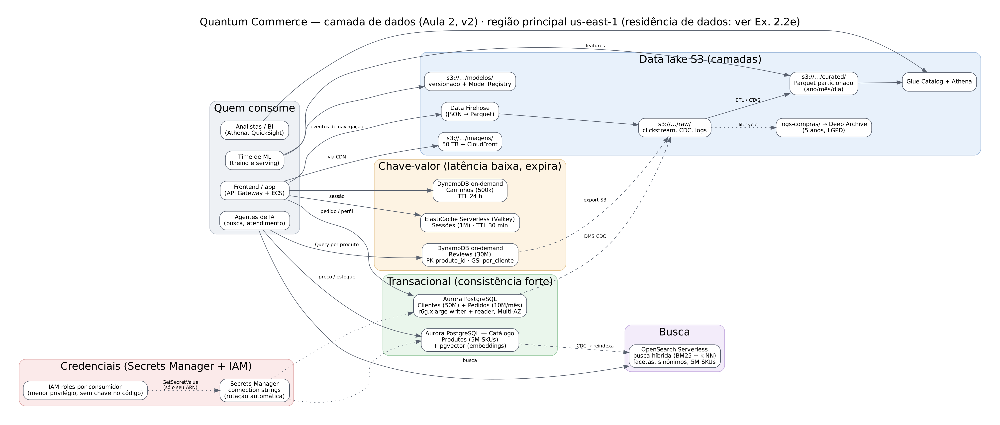

# Entrega Aula 02 — Grupo 01

**Disciplina:** Cloud & Cognitive Environments — FIAP MBA AI Engineering & Multi-Agents
**Turma:** 6AIER
**Data de entrega:** 18/11/2026

## Grupo

| # | Nome completo | GitHub | E-mail FIAP |
|---|---------------|--------|-------------|
| 1 | Julio Cesar da Silva | [@juliocs84](https://github.com/juliocs84) | rm379254@fiap.com.br |
| 2 | Eduardo Oliveira Santos Cunha | [@educunhamxk](https://github.com/educunhamxk) | rm379314@fiap.com.br |

## Distribuição do trabalho

Rodízio em relação à Entrega 01: Eduardo fez o N1 na Aula 1 e assume o N2 agora; Julio fez N2/N3 e assume o N1 e o N3 (bônus).

| Membro | Nível assumido | Item específico |
|--------|----------------|-----------------|
| Eduardo Oliveira Santos Cunha | 🟡 N2 | Exercícios 2.1 (canvas de decisão + diagrama), 2.2 (plano de migração) e 2.3 (particionamento no DynamoDB) |
| Julio Cesar da Silva | 🟢 N1 | Exercícios 1.1, 1.2, 1.3 e 1.4 (com as políticas IAM em `iam/`) |
| Julio Cesar da Silva | 🔴 N3 (bônus) | Exercícios 3.1 (busca híbrida), 3.2 (data lake em camadas) e 3.3 (benchmark) — scripts em `scripts/` |
| Ambos | — | Reflexão coletiva, uma linha do canvas cada, revisão cruzada |

---

## 🟢 Nível 1 — Respostas

### 1.1 — Tipos de storage

| Cenário | Tipo | Justificativa |
|---------|------|---------------|
| Imagens de produtos (5M SKUs) | **Object** (S3 + CloudFront) | Milhões de arquivos imutáveis servidos por HTTP, sem hierarquia de pastas nem montagem em servidor; escala e custo por GB imbatíveis. |
| Disco do SO de uma VM de banco | **Block** (EBS gp3/io2) | O SO e o banco precisam de um disco de baixa latência e acesso aleatório em bloco, anexado a uma única instância. |
| Pasta compartilhada entre 10 VMs | **File** (EFS) | Precisa ser montada por várias máquinas ao mesmo tempo com semântica POSIX (`/mnt/dados`). |
| Backup mensal com retenção de 7 anos | **Object** (S3 Glacier Deep Archive) | Escrito uma vez e quase nunca lido: a classe mais barata do S3, com Object Lock para imutabilidade. |
| Modelos `.pkl` para serving | **Object** (S3 versionado) | Artefato imutável baixado pelo endpoint na inicialização; o versionamento do objeto dá rastreabilidade e rollback. |
| Dump diário de logs para análise | **Object** (S3 com lifecycle) | Volume crescente, consultado em lote com Athena sobre o próprio S3; o lifecycle desce para IA/Glacier conforme envelhece. |

### 1.2 — Tiers de acesso (regime estável: 120 TB = 122.880 GB)

**a) Tudo em S3 Standard:** 122.880 GB × US$ 0,023 = **US$ 2.826,24/mês** (≈ US$ 33.915/ano).

**b) Com lifecycle (30 dias em Standard, depois Deep Archive):** só o mês corrente fica em Standard.
- Standard: 2.048 GB × US$ 0,023 = US$ 47,10
- Deep Archive: 120.832 GB × US$ 0,00099 = US$ 119,62
- **Total: US$ 166,73/mês**

**c) Economia anual:** (2.826,24 − 166,73) × 12 = **US$ 31.914,12/ano**, uma redução de **≈ 94%**.

**O que a conta não mostra:**
- **Leitura cara e lenta:** recuperar do Deep Archive leva até 12 h (Standard) ou 48 h (Bulk) e é cobrado por GB. Num pedido da ANPD ou de auditoria, o prazo de resposta precisa considerar esse tempo.
- **Permanência mínima de 180 dias:** apagar antes disso cobra o restante.
- **Custo por objeto na transição:** milhões de arquivos pequenos de log tornam a transição cara. Por isso agrupamos os logs em arquivos grandes (ex.: Parquet diário) antes de arquivar.
- **Implementação:** regra `logs-compras-deep-archive` em `terraform/storage.tf` (transição aos 30 dias, expiração aos 5 anos), mais uma regra que aborta uploads multipart incompletos após 7 dias.

### 1.3 — Relacional vs NoSQL vs Vector

| Caso de uso | Relacional (RDS PostgreSQL) | NoSQL (DynamoDB) | Vector DB (pgvector) | Justificativa |
|-------------|:--:|:--:|:--:|---------------|
| Carrinho de compras ativo | | ✅ | | Acesso sempre por `cliente_id`, item de esquema variável que expira: chave-valor com TTL de 24 h. |
| Catálogo com SKU, preço e estoque | ✅ | | | Esquema estável, filtros e joins com categoria, e o estoque precisa de integridade transacional junto com o pedido. |
| Reviews (texto livre + score) | | ✅ | | Leitura sempre "todas as reviews do produto X" (partition key), volume grande e sem joins. |
| "Produtos similares a este" | | | ✅ | Similaridade semântica entre embeddings (vizinho mais próximo), o que nem SQL nem chave-valor resolvem. |
| Histórico de pedidos para faturamento | ✅ | | | Dinheiro e nota fiscal exigem ACID, constraints e auditoria. |
| Sessão (chave-valor, expira em 30 min) | | ✅ | | Chave-valor puro com TTL. Se a latência sub-ms for crítica, ElastiCache (Valkey) em vez de DynamoDB. |
| Logs de navegação | | (✅) | | Na prática, **nenhum dos três**: bilhões de eventos consultados em lote vão para S3 + Athena (Parquet). DynamoDB só se houver leitura online por usuário (ex.: "vistos recentemente"). |

### 1.4 — Secrets Manager e IAM (menor privilégio)

As cinco políticas estão em `iam/*.json`, com JSON validado. O segredo do lab se chama `qc-aula02-<sufixo>/postgres`, e o ARN dele termina com 6 caracteres aleatórios. Por isso a política da Lambda usa o curinga `-??????`, que fixa o segredo exato sem amarrar a versão.

| Perfil | Ações IAM no Secrets Manager | Justificativa |
|--------|------------------------------|---------------|
| Você (dev e ops do lab) — `iam/1-dev-ops-lab.json` | `secretsmanager:*` só em `arn:aws:secretsmanager:us-east-1:*:secret:qc-aula02-*`; `ListSecrets` e `GetRandomPassword` em `*`, porque essas duas ações não aceitam restrição por recurso | Controle total, mas só sobre os segredos do projeto. Nunca `Resource: "*"` para as ações de leitura e escrita. |
| Lambda que lê a connection string — `iam/2-lambda-le-connection-string.json` | Só `secretsmanager:GetSecretValue` no ARN `…:secret:qc-aula02-*/postgres-??????`, com condição `VersionStage = AWSCURRENT`, na **execution role** da função | A função lê **um** segredo e só a versão vigente. Se for comprometida (ex.: injeção via agente), não enumera nem lê outros segredos. |
| Engenheiro de segurança (auditoria sem valores) — `iam/3-auditor-sem-valores.json` | `ListSecrets`, `DescribeSecret`, `ListSecretVersionIds`, `GetResourcePolicy`; **Deny explícito** em `GetSecretValue` e `BatchGetSecretValue` | Vê quem tem rotação, datas, tags e policies, mas nunca o valor. O Deny explícito vence qualquer Allow herdado de outra política. |
| Pipeline de CI/CD (cria e rotaciona) — `iam/4-cicd-cria-e-rotaciona.json` | `CreateSecret` e `TagResource` com condição `aws:RequestTag/projeto = quantum-commerce`; `PutSecretValue`, `UpdateSecret`, `RotateSecret`, `CancelRotateSecret`, `DescribeSecret` no prefixo; `GetRandomPassword` | Cria segredos já etiquetados (FinOps e ABAC) e rotaciona, mas **não lê** o valor (sem `GetSecretValue`). A role é assumida via OIDC, sem chave estática. |
| Time de FinOps (custo sem valores) — `iam/5-finops-custo-sem-segredos.json` | **Nenhuma** ação no Secrets Manager; só `ce:GetCostAndUsage`, `ce:GetCostForecast`, `ce:GetDimensionValues`, `ce:GetTags` | O custo dos segredos (US$ 0,40/segredo/mês + chamadas de API) aparece no Cost Explorer filtrado pela tag `projeto`. Observação: o Cost Explorer não aceita restrição por recurso, então o filtro por tag é feito na consulta, e não imposto pela política. |

> No AWS Academy Learner Lab não é possível criar roles nem políticas IAM, porque tudo roda com a `LabRole`. Por isso as políticas são entregues como JSON, e não aplicadas.

---

## 🟡 Nível 2 — Respostas + Implementação

### 2.1 — Modelagem de dados da QC (matriz de decisão)

O **canvas completo**, com a pergunta que cada dado responde, volume, tolerância a erro, credencial, custo estimado e justificativa, está em **`canvas-decisao.md`**. Resumo:

| Domínio | Serviço AWS escolhido | Tipo/Configuração | Justificativa em 1-2 frases |
|---------|-----------------------|-------------------|------------------------------|
| Produtos | Aurora PostgreSQL + S3/CloudFront | Cluster de catálogo `r6g.large` writer + reader; imagens em S3 com CDN | Esquema estável com filtros e joins; o estoque precisa de integridade. As imagens são objetos servidos por HTTP. |
| Clientes | Aurora PostgreSQL | Cluster transacional (com Pedidos), Multi-AZ, criptografado | Dado pessoal com integridade referencial com pedidos e controle por coluna (LGPD). |
| Pedidos | Aurora PostgreSQL | `r6g.xlarge` writer + reader, Multi-AZ; histórico via DMS CDC para o lake | ACID para dinheiro; o histórico antigo sai do banco quente para o S3. |
| Carrinhos | DynamoDB | On-demand, PK `cliente_id`, **TTL 24 h** | Chave-valor de esquema variável que expira sozinho, sem job de limpeza. |
| Reviews | DynamoDB | On-demand, PK `produto_id` + SK `review_id`, **GSI `por_cliente`** | Sempre lidas por produto (ou por cliente); 30M textos sem joins. |
| Busca de produtos | OpenSearch Serverless | Busca híbrida BM25 + k-NN, alimentada por CDC do catálogo | Busca por palavra (marca, modelo) e por significado (intenção) na mesma consulta, com facetas. |
| Sessões | ElastiCache Serverless (Valkey) | TTL 30 min | Lida em toda requisição: latência sub-ms. |
| Histórico navegação | Data Firehose → S3 + Athena | Parquet particionado por ano/mês/dia | Bilhões de eventos consultados em lote: storage barato e SQL sob demanda. |
| Modelos ML | S3 + SageMaker Model Registry | Bucket versionado, artefatos imutáveis | Artefato é objeto; o registry dá versão, aprovação e linhagem. |

**Custo estimado da camada de dados: ≈ US$ 3.930/mês**, em preço de lista on-demand na `us-east-1`, com as premissas detalhadas no canvas.

**Diagrama:** `diagramas/arquitetura-qc-aula02.png` (fonte editável em `.dot`).



### 2.2 — Plano de migração de dados (12 meses)

**a) e b) R escolhido e destino por repositório**

| Repositório atual | R | Destino AWS | Por quê |
|-------------------|---|-------------|---------|
| Oracle on-premises, 8 TB (produtos + pedidos + clientes) | **Replatform**, com **Refactor** gradual dos domínios | Aurora PostgreSQL (clusters de catálogo e transacional) + DynamoDB para carrinhos e reviews | Sai da licença Oracle (o maior custo) e ganha HA gerenciada. A conversão de schema e PL/SQL é o esforço central. Domínios chave-valor vão para DynamoDB quando forem reescritos. |
| NAS com 50 TB de imagens | **Rehost** (de arquivo para objeto, sem mudar o conteúdo) | S3 Standard + CloudFront; Intelligent-Tiering para a cauda longa de SKUs pouco vistos | Imagem é objeto por natureza: o NAS vira bucket. Lifecycle e Intelligent-Tiering cuidam do custo. |
| ~200 TB de logs em fita (compliance fiscal) | **Retain** até digitalizar e depois **Rehost** para arquivo frio; o que passar do prazo legal vira **Retire** | S3 Glacier Deep Archive com Object Lock (modo compliance) | Ninguém consulta, mas a lei exige guardar. Deep Archive custa ≈ US$ 0,00099/GB/mês, ou seja, ≈ US$ 203/mês para 200 TB. |

**c) Como migrar sem downtime**

| Mês | Fase | Ferramenta |
|-----|------|------------|
| 1–2 | Landing zone, rede (Direct Connect ou VPN), IAM, KMS; avaliação do schema Oracle | AWS **Schema Conversion Tool** (relatório de conversão Oracle → PostgreSQL) e DMS Schema Conversion |
| 2–4 | Imagens: cópia online e incremental do NAS para o S3 | **AWS DataSync** (agente no data center, verificação de integridade, sincronizações incrementais até o corte) |
| 3–5 | Fitas: leitura das fitas para disco e envio offline | **Snowball Edge Storage Optimized 210 TB**: 200 TB pela rede levariam semanas e saturariam o link; o dispositivo é enviado de volta para a AWS |
| 4–8 | Banco: carga inicial e replicação contínua | **AWS DMS** full load + **CDC**: o Oracle continua sendo a fonte da verdade enquanto o Aurora acompanha em tempo quase real |
| 8–10 | Dupla execução e validação | DMS data validation, comparação de contagens e somas, leituras sombra |
| 10–11 | **Cutover** por domínio, em janela curta | Congela escritas por minutos, espera o lag do CDC zerar, troca a connection string (Secrets Manager) e mantém o CDC reverso pronto para rollback |
| 12 | Desligamento do Oracle e do NAS, e otimização | Retire on-premises, Reserved Instances / Savings Plans, revisão de custos |

**d) Custo de transferência dos 50 TB de imagens**
- **Entrar na AWS:** US$ 0 de data transfer in. O custo é da ferramenta: DataSync a ≈ US$ 0,0125/GB × 51.200 GB ≈ **US$ 640** (uma vez), mais o link.
- **Manter:** 51.200 GB × US$ 0,023 ≈ **US$ 1.178/mês** em S3 Standard, menos com Intelligent-Tiering.
- **Sair depois (para a internet):** os primeiros 100 GB/mês são grátis, de 100 GB a 10 TB custa US$ 0,09/GB e de 10 a 50 TB, US$ 0,085/GB → (10.240 − 100) × 0,09 + 40.960 × 0,085 ≈ **US$ 4.394**, quase 7× o custo de entrada. É o *data gravity* que cria lock-in. Servir as imagens pelo CloudFront reduz o egress do dia a dia, porque a transferência do S3 para o CloudFront é gratuita.

**e) Compliance LGPD: onde os dados de brasileiros podem ficar**
- A LGPD **não exige** que os dados fiquem no Brasil. Ela regula a **transferência internacional** (arts. 33 a 36), permitida, entre outras hipóteses, para país com nível adequado de proteção ou com **cláusulas contratuais padrão** aprovadas pela ANPD (Resolução CD/ANPD nº 19/2024). A AWS oferece um adendo de processamento de dados (DPA) aos clientes.
- **Nossa decisão para a QC:** dados pessoais de clientes brasileiros (perfil, endereço, pedidos) na **`sa-east-1` (São Paulo)**. Isso reduz latência para o cliente e risco regulatório, e simplifica a resposta à ANPD. Analytics anonimizado e agregado pode ficar na `us-east-1`.
- **Controles:** criptografia com KMS (chave por domínio), Lake Formation e controle por coluna para dado pessoal, CloudTrail, retenção alinhada à finalidade, e processo de exclusão a pedido do titular que alcance também o lake e os backups.

### 2.3 — Particionamento no DynamoDB (`reviews`: PK `produto_id`, SK `review_id`)

**a) Por que NÃO usar como chave de partição:**

- **`review_id` sozinho** (3 razões):
  1. A consulta do agente, "reviews do produto X", deixa de ser um `Query` e vira `Scan` + filtro, que lê a tabela inteira a cada pergunta.
  2. Não dá para ordenar nem paginar as reviews de um produto (não há sort key agrupando-as).
  3. Agregações por produto ("nota média", "últimas 10") exigiriam ler tudo, ou manter um índice paralelo que custa escrita e armazenamento em dobro.
- **`score` (1–5)** (2 razões):
  1. Só existem 5 valores possíveis: 30M de itens em 5 partições lógicas. Partições quentes (o score 5 concentra a maioria) estouram o limite de vazão por partição (3.000 RCU / 1.000 WCU).
  2. Nenhuma consulta real começa por "todas as reviews nota 5 da loja inteira". O acesso natural é por produto.
- **`data_da_review` (timestamp)** (2 razões):
  1. Toda escrita nova cai no "agora": a partição do momento fica quente e as antigas ficam ociosas (padrão de escrita monotônica).
  2. É impossível buscar "reviews do produto X" sem varrer todas as datas. Se for chave de igualdade exata (timestamp completo), cada partição tem praticamente um item só.

**b) `produto_id` funciona razoavelmente bem, mas pode gerar *hot partition*.** A distribuição de acesso no e-commerce é de cauda longa. Um produto viral, em promoção ou com ação de influenciador recebe muito mais leituras e escritas que os outros. Todas caem no **mesmo valor de partition key**, e o limite por partição física é de ≈ 3.000 RCU e 1.000 WCU. Isso causa throttling mesmo com a tabela on-demand, que distribui capacidade, mas não divide uma chave sozinha. O *adaptive capacity* e o *split for heat* ajudam, mas uma chave única continua com teto.

Mitigações:
- **Cache** com DAX ou ElastiCache para as leituras do produto quente.
- **Write sharding** (`produto_id#N` com N aleatório de 0 a 9, e leitura com fan-out de 10 queries).
- **Resumo pré-agregado** (nota média, contagem) num item separado, atualizado via DynamoDB Streams, para não ler as 50 mil reviews a cada página.

**c) "Todas as reviews de um cliente": Global Secondary Index.** Criamos o GSI **`por_cliente`**, com PK `cliente` e SK `review_id`, e projeção `INCLUDE` de `produto_id`, `score` e `texto`. Implementado em `terraform/dynamodb.tf`; os itens do lab já gravam o atributo `cliente`.
- O DynamoDB mantém o índice sozinho, com **consistência eventual** (a review aparece no índice depois de alguns ms).
- Cada escrita na tabela gera também uma escrita no GSI, que é cobrada.
- A projeção parcial evita duplicar o item inteiro.
- Consulta: `Query(IndexName="por_cliente", KeyConditionExpression=Key("cliente").eq("cliente-123"))`.
- Um LSI **não** serviria: ele mantém a mesma partition key (`produto_id`) e só troca a sort key.

**d) Estimativa: produto com 50.000 reviews de ~400 bytes**
- 50.000 × 400 B = 20.000.000 B ≈ **19,1 MiB** nesse valor de partition key.
- **Limite de 400 KB por item:** não é problema, porque cada review é um item de ~0,4 KB, mil vezes abaixo do limite. Seria um problema se alguém modelasse "um item por produto com a lista de reviews dentro": 20 MB não cabem em 400 KB, o que é um anti-padrão.
- **Limite de 10 GB por valor de partition key** (vale quando a tabela tem LSI): 19,1 MiB são **≈ 0,19%** do limite. Para chegar lá, o produto precisaria de 10 GiB ÷ 400 B ≈ **26,8 milhões de reviews**. Sem LSI (o nosso caso, com GSI) não há limite por chave, e o DynamoDB divide a chave em várias partições físicas pela sort key quando ela cresce.
- O gargalo real é **vazão**, não tamanho: ler as 50 mil reviews de uma vez custa ≈ 20 MB ÷ 4 KB = 4.883 RCU (2.442 com leitura eventual) e 20 páginas de 1 MB. Por isso a tela mostra as reviews paginadas e um resumo pré-agregado.

---

## 🔴 Nível 3 — Bônus

Scripts em `scripts/`; comandos em `README.md`. **Todos os resultados abaixo foram obtidos no AWS CloudShell em 17/11/2026**, com o RDS PostgreSQL 16 + pgvector e o DynamoDB do lab da Aula 2 (`us-east-1`) e o modelo de embedding do lab (`paraphrase-multilingual-MiniLM-L12-v2`, 384 dimensões). As saídas completas estão em `evidencias/`.

### 3.1 — Busca híbrida: vetor + full-text no mesmo PostgreSQL

**Implementação (`scripts/buscar_hibrido.py`):**
1. Garante a coluna `tsv` (`tsvector` gerada em português, `STORED`) e o índice GIN com `ADD COLUMN IF NOT EXISTS` / `CREATE INDEX IF NOT EXISTS`. É idempotente porque o `qc indexa` recria a tabela do zero.
2. Busca por **palavra**: `plainto_tsquery('portuguese', …)` + `ts_rank`, top 10.
3. Busca por **significado**: embedding da consulta com o mesmo modelo do `qc indexa` + `embedding <=> vetor` (cosseno), top 10.
4. **RRF:** `score(d) = Σ 1/(60 + posição_d)` sobre as duas listas; desempate pelo id. Mostra o top 3 dos três modos e grava a tabela em Markdown (`--saida`).

**Resultados (top 3)**, de `evidencias/resultados-3.1.md`:

| Consulta | Palavra | Vetor | Híbrido (RRF) |
|----------|---------|-------|---------------|
| "Dell Inspiron" | ✅ Notebook Dell Inspiron 15 (#2) · — · — | ✅ Notebook Dell Inspiron 15 (#2) · Tênis Adidas Ultraboost 23 (#10) · Smartphone Samsung Galaxy S24 (#5) | ✅ Notebook Dell Inspiron 15 (#2) · Tênis Adidas Ultraboost 23 (#10) · Smartphone Samsung Galaxy S24 (#5) |
| "algo para trabalhar em pé" | ❌ *(nenhum resultado)* | ⚠️ Cadeira Home Office Confortável (#14) · **Mesa de Escritório com Regulagem de Altura (#6)** · Cadeira Ergonômica DXRacer (#1) | ⚠️ idem ao vetor |
| "presente para quem gosta de correr" | ❌ *(nenhum resultado)* | ⚠️ Cadeira Gamer Vermelha (#7) · Tênis Adidas Ultraboost 23 (#10) · **Tênis Nike Air Zoom Pegasus 40 (#4)** | ⚠️ idem ao vetor |

✅ produto certo em 1º · ⚠️ produto certo no top 3, mas não em 1º · ❌ não encontrou. Em negrito, o produto que melhor responde à pergunta.

**Reflexão:**

1. **Onde cada modo falhou e por quê**
   - **Palavra** falhou nas duas consultas em linguagem natural (zero resultados). O `plainto_tsquery` faz **E lógico** de todos os lexemas que não são stopwords: nenhum produto tem "trabalhar" **e** "pé", nem "presente" **e** "gosta" **e** "correr". O produto certo existe ("Mesa **em pé** com motor elétrico", "Tênis **para corrida**"), mas não com todas as palavras da pergunta. Em compensação, foi a **mais precisa** em "Dell Inspiron": devolveu só o notebook, sem ruído.
   - **Vetor** acertou o 1º lugar em "Dell Inspiron", mas completou o top 3 com ruído sem relação (tênis Adidas, smartphone Samsung): para um identificador de marca e modelo, os vizinhos seguintes no espaço vetorial são aleatórios. Nas frases naturais, encontrou a **intenção** que a palavra não achou, mas com o **1º lugar errado**: "trabalhar em pé" trouxe primeiro uma *cadeira* (o modelo associou "trabalhar" a home office), com a mesa em pé só em 2º; e "quem gosta de correr" trouxe primeiro uma **cadeira gamer**, com o tênis de corrida (Pegasus) só em 3º. É o caso "parecido, mas errado" do lab: um agente que confiasse no top 1 recomendaria uma cadeira para um corredor.
   - **Híbrido** ficou **idêntico ao vetor** nas três consultas. Em "Dell Inspiron" os dois modos concordaram no 1º lugar, e o RRF não tinha o que corrigir. Nas frases naturais, a lista por palavra veio vazia, então a fusão não teve com o que combinar. **Lição:** o RRF só melhora o ranking quando os dois modos trazem candidatos. Com `plainto_tsquery` (E lógico) a perna lexical some justamente nas perguntas em linguagem natural. Para a QC, as melhorias seriam:
     - perna lexical mais tolerante: `websearch_to_tsquery` com OU entre termos, ou um índice trigram (`pg_trgm`);
     - sinônimos ("correr" ~ "corrida"; "em pé" ~ "regulagem de altura");
     - um modelo de embedding maior que o MiniLM de 384 dimensões;
     - um *reranker* (ex.: Cohere Rerank no Bedrock) sobre o top 10 fundido;
     - para o agente, confirmação de categoria ou uma pergunta de esclarecimento quando a similaridade do 1º lugar for baixa.
2. **Modelo de embedding em produção:** **Amazon Titan Text Embeddings V2** (multilíngue, dimensão configurável de 256 a 1024, baixo custo por token e nativo do Bedrock) para começar. **Cohere Embed Multilingual** se a qualidade em português for o critério decisivo. Em ambos os casos, avaliar com um conjunto de consultas reais da QC (recall@10, nDCG) antes de decidir, e versionar o modelo junto com o índice, porque trocar de modelo exige reindexar tudo.
3. **Embeddings atualizados com produtos novos:** pipeline incremental. Um produto novo ou alterado gera um evento (S3 `PutObject` no `catalogo/` ou CDC do Aurora via EventBridge) → SQS → Lambda que chama o Bedrock e faz `UPSERT` só do produto alterado (com hash do texto para não reprocessar o que não mudou) → DLQ para falhas. Uma reindexação completa periódica fica para troca de modelo.
4. **Quando trocar o pgvector:**
   - Por **OpenSearch**: com milhões de vetores e alta concorrência, quando a busca começa a competir por CPU e memória com o OLTP; quando são necessárias facetas, sinônimos, analisadores por idioma, BM25 de verdade e busca híbrida nativa; ou quando o time de busca precisa escalar o índice separado do banco.
   - Por **Bedrock Knowledge Bases**: quando o caso é RAG sobre **documentos** (manuais, políticas, FAQ) e se quer o pipeline inteiro gerenciado (chunking, embeddings, sincronização e recuperação) sem escrever código de indexação.
   - O pgvector continua ótimo para dados que já estão no PostgreSQL, escala moderada e quando se quer filtro SQL e vetor na mesma transação.

### 3.2 — O data lake da QC em camadas

**1. Camadas, origem, consumidores e acesso**

| Camada | O que entra (origem) | Formato / organização | Quem consome | Quem pode ler, e por quê |
|--------|----------------------|------------------------|--------------|---------------------------|
| `raw/` (bronze) | Clickstream (Data Firehose), pedidos e clientes (DMS CDC do Aurora), logs de compras (aplicação), exports de reviews (DynamoDB → S3) | Como chegou (JSON/CSV), particionado só por data de ingestão; imutável, versionado | Jobs de ETL (Glue/EMR) e engenharia de dados para reprocessamento | **Só os jobs de ETL e a engenharia de dados.** Contém dado pessoal sem tratamento e erros de origem: ler daqui é arriscado (LGPD) e gera números errados. |
| `curated/` (prata) | Saída do ETL: deduplicado, tipado, com PII mascarada ou tokenizada | **Parquet + Snappy**, particionado por `ano/mes` (e `dia` no clickstream), porque quase toda pergunta de negócio filtra por período | Analistas no Athena, time de ML (features) | **Analistas e ML**, com Lake Formation filtrando colunas sensíveis (CPF, e-mail) por papel. |
| `analytics/` (ouro) | Agregados prontos: vendas por dia/categoria/UF, funil, coortes | Parquet pequeno ou Iceberg, atualizado por job agendado | Painéis (QuickSight) e **agentes** (respostas do tipo "quanto vendemos ontem") | **Painéis e agentes, só leitura.** Dado agregado e sem PII: o agente pode responder sem nunca tocar dado pessoal. |

**2. DDL e consulta da camada curated**

```sql
CREATE EXTERNAL TABLE qc.logs_compras (
  pedido_id  string,
  produto_id int,
  valor      decimal(10,2),
  ts         timestamp
)
PARTITIONED BY (ano int, mes int)
STORED AS PARQUET
LOCATION 's3://<bucket>/curated/logs_compras/'
TBLPROPERTIES (
  'parquet.compression' = 'SNAPPY',
  -- partition projection: o Athena calcula as partições sem MSCK REPAIR nem crawler
  'projection.enabled'      = 'true',
  'projection.ano.type'     = 'integer', 'projection.ano.range' = '2024,2030',
  'projection.mes.type'     = 'integer', 'projection.mes.range' = '1,12',
  'storage.location.template' = 's3://<bucket>/curated/logs_compras/ano=${ano}/mes=${mes}/'
);

SELECT mes, COUNT(*) AS pedidos, SUM(valor) AS receita
FROM qc.logs_compras
WHERE ano = 2026            -- poda de partição: lê só 1 dos 3 anos
GROUP BY mes ORDER BY mes;
```

O que reduz a leitura:
- **Particionamento** por ano/mês: o `WHERE ano = 2026` descarta 2/3 dos arquivos sem abri-los.
- **Parquet colunar:** a consulta lê só as colunas `mes` e `valor`, não `pedido_id`, `produto_id` e `ts`.
- **Compressão.**

**3. Custo no Athena (US$ 5 por TB lido)**

Medido no lab (`qc lake compara`, em `evidencias/resultados-3.2.txt`): para a mesma pergunta, o CSV leu **12,63 MB** e o Parquet particionado leu **23,2 KB**, ou seja, **R = 557× menos**.

| Cenário | Por consulta | 100 consultas/dia (3.000/mês) |
|---------|-------------|-------------------------------|
| 30 TB em CSV, sem partição (lê tudo) | 30 TB × US$ 5 = **US$ 150,00** | **US$ 450.000/mês** |
| Parquet particionado, lê 1 ano de 3, com a razão medida (R = 557) | 30 TB ÷ 557 ÷ 3 × US$ 5 = **US$ 0,09** | **≈ US$ 269/mês** |
| **Mesmo cenário, com a razão corrigida (R ≈ 46)** | 30 TB ÷ 46,4 ÷ 3 × US$ 5 = **≈ US$ 1,08** | **≈ US$ 3.232/mês** |

**Por que corrigimos a razão:** a pergunta do lab filtra **um mês** (`mes = '2026-09'`) de um dado que cobre **12 meses** (out/2025 a set/2026). Os 557× já incluem a poda de 11 das 12 partições, além do ganho de formato. Aplicar 557× **e** dividir por 3 conta a poda de partição duas vezes. O ganho só de formato (Parquet colunar + Snappy) é ≈ 557 ÷ 12 ≈ **46×**, e é esse que se combina com "lê 1 ano de 3". A estimativa honesta para a QC fica em **≈ US$ 1/consulta e ≈ US$ 3,2 mil/mês**, contra **US$ 450 mil/mês** no CSV: ainda **≈ 140× mais barato**. Com uma camada ouro (agregado diário de receita por mês), o painel leria kilobytes e pagaria o mínimo de 10 MB por consulta do Athena (≈ US$ 0,00005).

**4. Athena × Redshift Serverless × lakehouse (Iceberg)**

| Opção | Passa a valer a pena quando… |
|-------|------------------------------|
| **Athena sobre Parquet** | Consultas exploratórias ou esporádicas, volume de consulta imprevisível, time pequeno. Paga só pelo que lê, não tem nada ligado. |
| **Redshift Serverless** | Muitas consultas concorrentes e repetitivas (painéis com dezenas de usuários, SLAs de segundos), joins pesados entre tabelas grandes. Com scan constante, o modelo por RPU-hora fica mais barato que pagar por TB lido a cada consulta, e o cache de resultados e as views materializadas ajudam. |
| **Lakehouse com Apache Iceberg** (como no case Junto Seguros) | Quando o lake precisa de **UPDATE/DELETE/MERGE**, por exemplo o CDC de pedidos ou o **direito ao esquecimento da LGPD** (apagar um cliente em Parquet puro exige reescrever arquivos à mão). Também para *time travel* para auditoria, evolução de schema sem quebrar consultas, e o mesmo dado lido por Athena, Redshift, EMR/Spark e Glue sem cópia. Para a QC, a camada curated de pedidos e clientes deveria ser Iceberg. |

### 3.3 — Benchmark: RDS × DynamoDB × pgvector

**Implementação (`scripts/benchmark_busca.py`):** pergunta "cadeira ergonômica para dor lombar", N = 10 execuções por opção, `time.perf_counter()`, aquecimento antes de medir. O embedding da pergunta é medido à parte, porque é gerado uma vez no cliente.
- **(a) RDS:** `ILIKE '%cadeira%'` em nome/descrição + `categoria = 'moveis'` + `preco <= 2000`.
- **(b) DynamoDB:** cria uma tabela temporária `PAY_PER_REQUEST` com os 20 produtos, faz `Scan` com `contains()` paginado, registra as RCUs consumidas (`ReturnConsumedCapacity`) e **apaga a tabela** no final.
- **(c) pgvector:** cosseno sobre os embeddings; **(c')** a híbrida do 3.1 para comparação.

**Resultados**, de `evidencias/resultados-3.3.md` (10 execuções por opção; embedding da pergunta: 12,5 ms, uma vez, no cliente):

| Opção | Média (ms) | p50 (ms) | Máx (ms) | Top 3 | Produto certo (#1 DXRacer, "apoio lombar") em 1º? |
|-------|-----------:|---------:|---------:|-------|:------------------------------------------------:|
| (a) RDS `ILIKE` + filtros | 1,4 | 1,3 | 2,4 | DXRacer (#1) · Gamer Vermelha (#7) · Home Office (#14) | sim |
| (b) DynamoDB `Scan` + `contains()` | 211,0 | 12,1 | 1.011,1 | DXRacer (#1) · Gamer Vermelha (#7) · Home Office (#14) | sim |
| (c) pgvector (sentido) | 1,5 | 1,3 | 2,5 | DXRacer (#1) · Gamer Vermelha (#7) · Home Office (#14) | sim |
| (c') híbrido RRF (3.1) | 2,8 | 2,6 | 4,1 | DXRacer (#1) · Gamer Vermelha (#7) · Home Office (#14) | sim |

Scan do DynamoDB: leu os **20 itens** da tabela para devolver 3, e consumiu **2,0 RCU por execução**.

**Leitura dos números:**
- **Latência:** RDS e pgvector empatam em ≈ 1,3 ms de p50 (20 linhas, rede na mesma região). O híbrido custa o dobro (≈ 2,6 ms) porque faz duas consultas. Somando os 12,5 ms do embedding da pergunta, o caminho vetorial fica em ≈ 14 ms, ainda irrelevante para um agente que leva centenas de ms no LLM.
- **Scan:** a média de 211 ms é distorcida pela 1ª execução (1.011 ms, que inclui abrir conexão TLS e descobrir o endpoint). O p50 de 12 ms já é **≈ 9× o do PostgreSQL** com apenas 20 itens, e cresce linearmente com o tamanho da tabela.
- **Qualidade:** com só três cadeiras no catálogo, as quatro opções trouxeram o mesmo top 3, com a DXRacer em 1º. O empate esconde diferenças importantes:
  - **(a)** acertou a ordem **por acaso**: o `ORDER BY preco DESC` pôs a cadeira mais cara (a DXRacer) em 1º. `ILIKE` não tem noção de relevância, e com outra ordenação o resultado mudaria.
  - **(b)** só funcionou porque o script gravou uma cópia do texto em minúsculas: `contains()` é sensível a maiúsculas e não faz stemming nem ranking.
  - **(c)** é a única que colocou a DXRacer em 1º **pelo significado** ("dor lombar" ≈ "apoio lombar regulável").
  - **(c')** ficou igual a (c): a perna lexical veio vazia, porque nenhum produto tem "dor", e repete-se a lição do 3.1.
- **O teste é pequeno demais para discriminar qualidade:** com 5M de SKUs e dezenas de cadeiras, só (c) e (c') ordenariam por relevância.

**Por que o Scan não escala:** o `Scan` **lê a tabela inteira** e o filtro só é aplicado **depois** da leitura, cobrado sobre tudo o que foi lido. No lab foram 20 itens e **2,0 RCU por execução, medidos**. Com o catálogo real de 5M de SKUs × ~1 KB ≈ 5 GB por consulta: 5 GB ÷ 4 KB ≈ 1,25M de RCUs (≈ 625 mil RRUs com leitura eventual) e ≈ 5.000 páginas de 1 MB, ou seja, segundos ou minutos de latência por pergunta.

**Custo projetado para 1M de consultas/mês** (`us-east-1`, preço de lista; conferível na [calculadora AWS](https://calculator.aws)):

| Opção | Projeção | Custo/mês |
|-------|----------|-----------|
| (a) RDS ILIKE | Roda na instância que já existe para o catálogo; custo marginal ≈ 0 enquanto couber na CPU. Com 5M de SKUs sem índice trigram, 1M de varreduras sequenciais exigiriam instância maior | ≈ US$ 0 marginal (instância já paga) |
| (b) DynamoDB Scan, catálogo de 5M | 1M × 625 mil RRU = 6,25 × 10¹¹ RRU × US$ 0,125/M | **≈ US$ 78.000** (inviável) |
| (c) pgvector | Mesma instância do catálogo + embedding da pergunta: 1M × ~10 tokens = 10M tokens no Titan Embeddings V2 | ≈ US$ 0,20 de embeddings + instância já paga |
| (c'') OpenSearch Serverless (produção) | Piso de 4 OCU com réplica | ≈ US$ 700 (fixo, não por consulta) |

**Recomendação para o agente de busca da QC:**
- **Agora (MVP, catálogo pequeno):** busca **híbrida no PostgreSQL** (pgvector + full-text + RRF, 3.1). Usa o banco que já existe, permite filtro SQL de preço e estoque na mesma consulta e tem custo marginal praticamente zero.
- **Em escala (5M de SKUs, alta concorrência):** migrar o índice para **OpenSearch** (híbrida nativa, facetas, sinônimos), alimentado por CDC do Aurora.
- **DynamoDB nunca** como mecanismo de busca por texto: ele é ótimo para "dê-me o item X", não para "encontre algo parecido com X".
- Em qualquer cenário, o agente deve **confirmar preço e estoque no Aurora** antes de responder, porque o índice de busca pode estar alguns segundos atrasado.

---

## Reflexão coletiva

**Segredos fora do código mudam o modelo de segurança de uma plataforma agentic.** Num app tradicional, a senha do banco num `.env` é um risco de vazamento. Num agente, ela é um risco de **exfiltração ativa**: o agente lê texto não confiável (reviews, e-mails, páginas) que pode conter *prompt injection*, e se a credencial estiver no contexto, no código ou nas variáveis de ambiente que ele enxerga, uma instrução maliciosa pode fazê-lo revelar ou usar essa credencial. Com o Secrets Manager:
- o agente **nunca vê o segredo**: quem o lê é a ferramenta (a Lambda), em tempo de execução, com uma role que só faz `GetSecretValue` em **um** ARN;
- cada acesso fica registrado no CloudTrail;
- a rotação automática limita a janela de um vazamento;
- revogar é trocar o segredo, sem redeploy.

**O controle de acesso deixa de ser "quem tem a senha" e passa a ser "qual identidade pode pedir qual segredo".** No 1.4 isso apareceu com clareza: o auditor vê metadados, mas tem `Deny` explícito no valor; o CI/CD cria e rotaciona, mas não lê; a Lambda lê só a versão vigente de um único segredo. Numa plataforma com dezenas de agentes e ferramentas, esse menor privilégio por ferramenta é o que impede que um agente comprometido vire acesso a todos os bancos.

**A pergunta que decide onde o dado mora vem antes do serviço.** O canvas nos obrigou a começar por "que pergunta esse dado responde" e "pode errar?". Pedidos não podem errar (Aurora, ACID). Carrinhos e sessões podem e expiram (DynamoDB e ElastiCache com TTL). Clickstream é lido em lote (S3 + Athena). A busca precisa de palavra **e** significado (híbrida), como o 3.1 mostrou: cada modo falha onde o outro acerta. E o custo segue a decisão: um Scan no lugar de um Query transforma centavos em dezenas de milhares de dólares (3.3), e Parquet particionado no lugar de CSV corta a fatura do Athena em uma ou duas ordens de grandeza (3.2).

**A linha do canvas de cada membro** (detalhada em `canvas-decisao.md`):
- **Julio:** séries de candles (OHLCV) de criptoativos e os sinais de um modelo de tendência. O canvas mostrou que são dois dados diferentes sobre o mesmo assunto. O volume é pequeno (estimativa de ~80 MB), então o que decide onde ele mora é o padrão de leitura, não o tamanho:
  - o histórico é lido em lote para treino e backtest, e cabe em **S3 Parquet particionado por ativo/ano**;
  - o sinal recente é lido por chave pela API, e cabe em **DynamoDB com TTL**;
  - a chave de API da exchange, hoje na configuração do backend, deveria ir para o **Secrets Manager**. É exatamente o ponto central desta reflexão.
- **Eduardo:** chamados de suporte de um sistema interno (~5 mil por mês). Hoje os relatórios de SLA rodam direto no banco operacional do sistema, e a senha do banco fica no arquivo de configuração da aplicação. Aplicando o canvas, ficou claro que são duas perguntas diferentes sobre o mesmo dado: "quais chamados estão abertos agora?" pode atrasar alguns minutos e é lida por chave, enquanto "qual foi o tempo médio de resolução por equipe no mês?" vira meta e não pode errar, mas é lida em lote. A decisão: a operação fica no **RDS PostgreSQL**, com a senha no **Secrets Manager** e rotação automática; o histórico é exportado para **S3 + Athena**, e os relatórios de SLA param de competir por CPU com o atendimento.

---

## Artefatos do ZIP

- Documento principal: `entrega-grupo-aula02.md`
- Canvas de decisão (N2): `canvas-decisao.md`
- Diagrama: `diagramas/arquitetura-qc-aula02.png` (fonte: `diagramas/arquitetura-qc-aula02.dot`)
- Terraform evoluído: `terraform/dynamodb.tf` (GSI `por_cliente`, Ex. 2.3c) e `terraform/storage.tf` (lifecycle Deep Archive, Ex. 1.2)
- Políticas IAM (Ex. 1.4): `iam/*.json`
- Scripts N3: `scripts/buscar_hibrido.py` (3.1) e `scripts/benchmark_busca.py` (3.3)
- Como rodar: `README.md`
- Evidências da execução no CloudShell (N3): `evidencias/resultados-3.1.md`, `evidencias/resultados-3.2.txt`, `evidencias/resultados-3.3.md`
