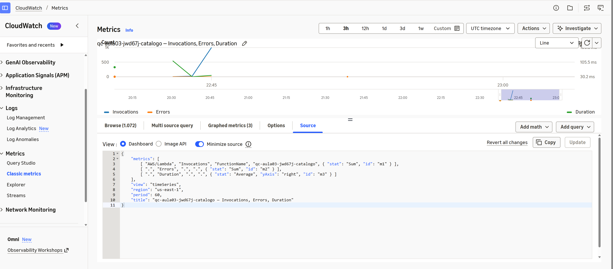

# Entrega Aula 03 — Grupo 01

**Disciplina:** Cloud & Cognitive Environments — FIAP MBA AI Engineering & Multi-Agents
**Turma:** 6AIER
**Data de entrega:** 19/11/2026

## Grupo

| # | Nome completo | GitHub | E-mail FIAP |
|---|---------------|--------|-------------|
| 1 | Julio Cesar da Silva | [@juliocs84](https://github.com/juliocs84) | rm379254@fiap.com.br |
| 2 | Eduardo Oliveira Santos Cunha | [@educunhamxk](https://github.com/educunhamxk) | rm379314@fiap.com.br |

## Distribuição do trabalho

Rodízio: Aula 1 (Eduardo N1, Julio N2/N3) → Aula 2 (Eduardo N2, Julio N1/N3) → Aula 3 (Julio N2, Eduardo N1 + N3 conceitual).

| Membro | Nível assumido | Item específico |
|--------|----------------|-----------------|
| Julio Cesar da Silva | 🟡 N2 | 2.1 (canvas de compute), 2.2 (tool de frete: código, Terraform, JSON Schema) e 2.3 (CloudWatch e alarme) |
| Julio Cesar da Silva | 🔴 N3 (bônus) | 3.2 (benchmark) e 3.4 (Fargate em produção) — execução no CloudShell |
| Eduardo Oliveira Santos Cunha | 🟢 N1 | 1.1, 1.2 (com a policy mínima em `iam/`), 1.3 e 1.4 |
| Eduardo Oliveira Santos Cunha | 🔴 N3 (bônus) | 3.1 (spec da tool para o agente) e 3.3 (Lambda pelas telas e drift) |
| Ambos | — | Reflexão coletiva, uma linha do canvas cada, revisão cruzada |

---

## 🟢 Nível 1 — Respostas

### 1.1 — Quando usar serverless?

| Cenário | Escolha | Justificativa |
|---------|---------|---------------|
| API de busca de produtos (1M chamadas/mês, picos na Black Friday) | **Lambda** | Paga por chamada (≈ US$ 0,83/mês para 1M de chamadas de 150 ms com 256 MB), escala sozinha nos picos e custa zero parada. |
| Worker que processa pedidos da fila (1.000/dia, picos noturnos) | **Lambda com gatilho SQS** | Orientado a evento: o *event source mapping* lê a fila em lote, escala com a profundidade da fila e manda falhas para a DLQ, sem servidor ocioso. |
| API legada em Java Spring Boot (não pode reescrever) | **ECS Express Mode** (ou ECS Fargate) | Roda o JAR como está, num container. O Express Mode cria serviço, ALB com HTTPS e auto scaling numa chamada, e o startup lento do Spring não sofre com cold start. |
| Pipeline de imagens de produtos (1 h por noite) | **ECS Fargate (tarefa agendada pelo EventBridge Scheduler)** | Passa do limite de 15 min da Lambda; paga por segundo enquanto roda e termina. |
| Microserviço de pagamentos (regulado, logs detalhados, 100 req/s constante) | **ECS Fargate** | Tráfego constante sem cold start, controle de rede e imagem (para auditoria), e conexões persistentes. A 100 req/s constantes o container 24/7 fica mais barato que pagar por invocação. |
| Plataforma com 25 microserviços + service mesh | **EKS** | Com dezenas de serviços, o ecossistema Kubernetes (Istio/Linkerd, Helm, operadores, GitOps) compensa o custo e a complexidade do cluster. |
| Container que extrai dados uma vez por dia e termina | **ECS Fargate (RunTask agendado)** | É exatamente o caso de uso: sobe, roda e some, sem serviço nem servidor ligados. |

### 1.2 — IAM Role vs alternativas

| Estratégia | Vulnerabilidade | Por quê |
|------------|-----------------|---------|
| Access key hardcoded no `lambda_function.py` | **Alta** | A chave é permanente e vai junto com o código para o Git, para o pacote da Lambda e para quem tem acesso de leitura à função. Robôs varrem o GitHub em minutos. |
| Access key em variável de ambiente da Lambda | **Alta** | Sai do código, mas continua sendo chave permanente: quem lê a configuração da função (`lambda:GetFunctionConfiguration`), o state do Terraform ou um log com dump do ambiente vê a chave em texto claro. |
| Segredo no Secrets Manager, lido com access key de um usuário IAM | **Média** | O segredo do banco está protegido, mas a chave que abre o cofre é permanente e precisa morar em algum lugar. O problema só mudou de lugar. |
| Segredo no Secrets Manager, lido com a execution role | **Baixa** | Não existe chave permanente: a Lambda recebe credenciais temporárias da role (rotacionadas automaticamente), e a role pode ler só aquele ARN. Tudo fica auditado no CloudTrail. |
| Sem segredo: a role tem permissão direta no recurso (S3) | **Baixa (a melhor)** | Não há segredo para vazar nem rotacionar: o acesso é a própria identidade da função, limitado por policy ao recurso exato. |

**Vazamento do código no GitHub:**
- **Continua sendo problema** nas estratégias 1 e 3. Na 1 a chave está no próprio código. Na 3, se a chave do usuário IAM estiver no código ou em arquivo versionado, quem a tiver lê o cofre inteiro que ela alcança.
- **Na estratégia 2**, o código vazado não contém a chave, mas o modelo continua frágil: a chave permanente segue exposta na configuração da função e em qualquer pipeline que a injete.
- **Não é problema** nas estratégias 4 e 5. O código só contém o nome do segredo ou do bucket. Sem a identidade da função, que só existe dentro da AWS, ninguém lê nada. É a lição do caso Capital One: o problema lá não foi código vazado, foi uma role com permissão demais. Por isso a policy precisa ser mínima.

**A policy mínima da `buscar_produtos`** (`iam/role-buscar-produtos.json`, com trust policy em `iam/trust-lambda.json`):

```json
{
  "Version": "2012-10-17",
  "Statement": [
    {
      "Sid": "LerSoOCatalogo",
      "Effect": "Allow",
      "Action": "s3:GetObject",
      "Resource": "arn:aws:s3:::qc-aula03-*-catalogo/catalogo/*"
    },
    {
      "Sid": "EscreverOProprioLog",
      "Effect": "Allow",
      "Action": ["logs:CreateLogStream", "logs:PutLogEvents"],
      "Resource": "arn:aws:logs:us-east-1:*:log-group:/aws/lambda/qc-aula03-*-catalogo:*"
    }
  ]
}
```

O que ficou de fora, de propósito:
- `s3:ListBucket`, `s3:PutObject` e `s3:*`.
- Qualquer outro bucket ou prefixo.
- `logs:CreateLogGroup`: o log group já é criado pelo Terraform, com retenção de 7 dias.

Comparada à LabRole do lab, que alcança quase toda a conta, um bug ou uma *prompt injection* nessa função consegue no máximo ler o catálogo, que é público por natureza. Em produção o ARN do bucket seria o literal, sem `*`. A tool de frete fica ainda mais restrita: só escreve o próprio log (`iam/role-calcular-frete.json`).

### 1.3 — Cold start na prática

O script `scripts/evidencias.sh frio` faz a chamada 1 logo depois de forçar um ambiente novo (uma atualização de configuração), espera 5 s, faz a chamada 2 e extrai as linhas `REPORT` do CloudWatch. A chamada 3 sai com `evidencias.sh frio3`, 30 minutos depois. Saída completa em `evidencias/1.3-cold-start.txt`.

| Chamada | Tempo (curl, do CloudShell) | Teve `Init Duration`? | Linha `REPORT` |
|---------|------------------------------|------------------------|----------------|
| 1 (fria) | **896 ms** | **Sim: 487,36 ms** | Duration 194,94 ms · Billed 683 ms · 92 MB usados |
| 2 (quente, 5 s depois) | **87 ms** | Não | Duration 29,49 ms · Billed 30 ms |
| 3 (8 min depois) | **233 ms** | **Não** (ambiente ainda vivo) | Duration 180,82 ms · Billed 181 ms · 93 MB usados |

A chamada fria custou **~10× a quente**: 487 ms de init (subir o Python, importar o boto3, criar o cliente S3), mais a 1ª leitura do S3 (195 ms contra 29 ms na quente), mais o estabelecimento da conexão TLS. O tempo de 896 ms é o mesmo que o grupo mediu no lab (`qc compara`: 897 ms frio, 167 ms quente). A chamada 3 saiu com 8 minutos, e não 30. O ambiente ainda estava vivo (sem `Init Duration`), mas a execução levou 181 ms contra 29 ms da quente: depois de minutos parado, a conexão com o S3 precisou ser reaberta.

Numa rodada anterior, feita por engano com a versão `v1-mock` (sem S3; ver nota em `evidencias/`), a chamada repetida depois de **6 minutos** de ociosidade veio **fria** (`Init Duration: 87 ms`). Juntas, as duas rodadas mostram o ponto central: **a AWS não garante por quanto tempo um ambiente ocioso sobrevive**. Com 6 minutos ele já foi reciclado uma vez; com 8 minutos, outra vez não. Não dá para projetar latência contando com o ambiente quente.

**24 chamadas/dia, uma por hora: quantas serão frias?** Na prática, **todas as 24**. A AWS não garante por quanto tempo um ambiente ocioso fica vivo. Na prática ele é reciclado em poucos minutos sem tráfego, e com 60 minutos entre chamadas cada uma encontra um ambiente novo. Com a UX exigindo < 500 ms, o cold start de ~0,9 s medido no lab estoura o limite em toda chamada.

**Mitigações e custo:**
- **Provisioned Concurrency:** mantém N ambientes inicializados. Para 1 instância de 256 MB: US$ 0,0000041667/GB-s × 0,25 GB × 2.628.000 s ≈ **US$ 2,74/mês**, mais a duração com desconto. Elimina o cold start para até N chamadas simultâneas, a um custo fixo. É a escolha certa para a busca e o frete se houver SLA de latência.
- **SnapStart (Python):** tira um snapshot da memória depois do `init` e restaura dele, reduzindo o tempo de init (ajuda quando o init é pesado: imports, carga de modelo). Cobra pelo armazenamento do snapshot e por cada restauração, e exige versões publicadas (`$LATEST` não serve). Ajuda menos quando o cold start é dominado pela rede.
- **Sem custo extra:**
  - deixar o init leve: imports mínimos, clientes boto3 criados uma vez fora do handler, como no lab;
  - aumentar a memória: mais CPU, init mais rápido;
  - usar arm64 (Graviton);
  - *ping* agendado a cada 5 min: barato, mas não garante nada sob concorrência.
- **Mudar de casa:** se o tráfego for constante, Fargate ou ECS Express não têm cold start.

### 1.4 — Dockerfile review

```dockerfile
FROM python:3.12
WORKDIR /app
COPY . .
RUN pip install -r requirements.txt
CMD ["python", "app.py"]
```

| # | Problema | Impacto | Correção |
|---|----------|---------|----------|
| 1 | `python:3.12` (imagem completa, ~1 GB) | Imagem enorme: push e pull lentos, mais pacotes do SO, mais CVEs no scan do ECR | `python:3.12-slim` (~150 MB), puxada do **ECR Public** (`public.ecr.aws/docker/library/python`) para fugir do limite de pull do Docker Hub |
| 2 | `COPY . .` **antes** do `pip install` | Qualquer mudança no código invalida o cache e reinstala todas as dependências a cada build; também copia `.git`, `.env`, `__pycache__` e testes para a imagem (risco de vazar segredo) | Copiar `requirements.txt` primeiro, instalar, e só depois o código; criar um `.dockerignore` |
| 3 | `pip install` sem `--no-cache-dir` | Cache do pip fica na camada (dezenas de MB inúteis) | `pip install --no-cache-dir` |
| 4 | Roda como **root** | Uma falha na aplicação vira root dentro do container, o que facilita escapar ou escalar privilégio | `RUN useradd --uid 10001 app` + `USER app` |
| 5 | Sem multi-stage | Compiladores e headers usados no build (ex.: para wheels nativas) ficam na imagem final | Estágio `builder` instala em `/install`; a imagem final só copia o resultado |
| 6 | `CMD ["python", "app.py"]` para um serviço web | Servidor de desenvolvimento, sem workers nem tratamento de sinais adequado | `uvicorn`/`gunicorn` explícito, com host e porta |
| 7 | Sem `EXPOSE`, sem `HEALTHCHECK`, versão de dependências solta | Contrato de porta implícito, o ECS não sabe se a aplicação está saudável, build não reprodutível | `EXPOSE 8080`, health check (no container ou no target group do ALB), `requirements.txt` com versões fixadas |

**Dockerfile corrigido**, alinhado ao do lab (`lab/docker/Dockerfile`):

```dockerfile
# syntax=docker/dockerfile:1
FROM public.ecr.aws/docker/library/python:3.12-slim AS builder
WORKDIR /build
COPY requirements.txt .
RUN pip install --no-cache-dir --target=/install -r requirements.txt

FROM public.ecr.aws/docker/library/python:3.12-slim
ENV PYTHONDONTWRITEBYTECODE=1 PYTHONUNBUFFERED=1
WORKDIR /app
COPY --from=builder /install /usr/local/lib/python3.12/site-packages
COPY app.py .
RUN useradd --create-home --uid 10001 app
USER app
EXPOSE 8080
HEALTHCHECK --interval=30s --timeout=3s --retries=3 \
  CMD python -c "import urllib.request; urllib.request.urlopen('http://localhost:8080/health', timeout=2)"
CMD ["python", "-m", "uvicorn", "app:app", "--host", "0.0.0.0", "--port", "8080"]
```

`.dockerignore`: `.git`, `.env*`, `__pycache__/`, `*.pyc`, `tests/`, `*.md`, `terraform/`.

**Comparação com o Dockerfile do lab:** o do lab já resolve os itens 1 a 6:
- ECR Public slim;
- multi-stage com `--no-cache-dir`;
- `requirements.txt` copiado antes do código;
- usuário não-root (`uid 10001`);
- `EXPOSE 8080`;
- `uvicorn` como módulo, um detalhe importante: o `pip --target` não instala o executável no PATH.

Ficaram de fora o `HEALTHCHECK` e o `PYTHONUNBUFFERED`. Sem este último, logs podem atrasar no CloudWatch por causa do buffer do stdout.

---

## 🟡 Nível 2 — Respostas + Implementação

### 2.1 — Canvas de compute da QC

O canvas completo está em **`canvas-compute.md`**: 5 cargas com identidade, custo na casa escolhida e na outra, o que não usaríamos e as premissas de cada estimativa. Resumo das decisões:

| Carga | Onde roda | Custo/mês (escolhida · alternativa) | Por quê, em uma linha |
|-------|-----------|-------------------------------------|-----------------------|
| Busca no catálogo | **Lambda** (256 MB) | US$ 0,83 · Fargate 24/7 US$ 9,01 + ALB | Picos e ociosidade: paga por chamada |
| Cálculo de frete | **Lambda separada** (128 MB) | US$ 0,02 · Fargate 24/7 US$ 9,01 | Função pura, role sem acesso a dados |
| Notas fiscais (noturno) | **Fargate RunTask agendado** | US$ 1,48 · Lambda US$ 18,48 | Lote de 1 h: passa dos 15 min da Lambda |
| Recomendação | **Treino em Fargate agendado + serving em Lambda** | US$ 5,03 · tudo em Fargate 24/7 ≈ US$ 36 | Lote pesado 1×/dia + leitura rápida pré-calculada |
| Checkout | **Fargate atrás de ALB**, mínimo 2 tarefas | ≈ US$ 52 · Lambda ≈ US$ 8 | Sem cold start no pagamento; conexões persistentes |

**O padrão que apareceu:** Lambda para chamadas curtas e irregulares; Fargate agendado para lotes longos; Fargate como serviço onde latência estável vale mais que o custo zero parado. As linhas de cada membro, com uma carga real do trabalho, estão no fim do canvas e na reflexão.

### 2.2 — Segunda tool para o agente: cálculo de frete

**a) Nova função, com Function URL própria (e não uma rota na mesma Lambda).**

| Critério | Rota na mesma Lambda | **Função separada (escolhida)** |
|----------|----------------------|---------------------------------|
| Permissão | Herdaria `s3:GetObject` do catálogo sem precisar | Role só com log: **zero acesso a dados** |
| Deploy | Mudança no frete republica a busca (e vice-versa) | Ciclos independentes; um bug no frete não derruba a busca |
| Escala e limite | Concorrência compartilhada | Concorrência reservada própria (evita que um pico da busca esgote o frete no checkout) |
| Configuração | 256 MB e timeout de 15 s para os dois | 128 MB e timeout de 5 s: dimensionada para um cálculo puro |
| Observabilidade | Métricas misturadas | Alarme e métricas por tool (`observabilidade.tf`) |
| Custo | Igual: a Lambda cobra por invocação e GB-s, e não por função | Igual |

**b) Implementação:** `function/v3-frete/lambda_function.py`, com 7 testes em `test_frete.py`, todos passando. Executada na AWS em 17/11/2026 (`evidencias/2.2-frete.txt`):

| Chamada | Resultado |
|---------|-----------|
| SP → SP, 2,5 kg | `local`, **R$ 15,75**, 2 dias úteis |
| SP → RJ, 2,5 kg (CEP com hífen e vírgula decimal) | `regional`, **R$ 24,25**, 4 dias úteis |
| SP → RS, 12,2 kg (cobra 12,5 kg) | `nacional`, **R$ 75,00**, 9 dias úteis (+2 por ser > 10 kg) |
| CEP `123`, peso `abc` | **400** com 2 mensagens: o CEP precisa de 8 dígitos e o peso precisa ser um número |

- **Entrada:** `GET /frete?cep_origem=01310100&cep_destino=20040002&peso_kg=2.5`. Aceita CEP com hífen e vírgula decimal.
- **Regra:** a região de origem e destino vem do 1º dígito do CEP (faixas dos Correios) e define o tipo de rota.

| Tipo de rota | Base | Por kg | Prazo |
|--------------|------|--------|-------|
| local | R$ 12,00 | R$ 1,50 | 2 dias úteis |
| regional | R$ 18,00 | R$ 2,50 | 4 dias úteis |
| nacional | R$ 25,00 | R$ 4,00 | 7 dias úteis |

  O peso cobrado é arredondado para cima em múltiplos de 0,5 kg (mínimo 0,5 kg). Acima de 10 kg, o prazo ganha +2 dias úteis.
- **Exemplo:** SP → RJ, 2,5 kg → `regional`, R$ 18,00 + 2,50 × 2,5 = **R$ 24,25**, 4 dias úteis.
- **Entrada inválida:** responde **400** com a lista de erros. O agente consegue corrigir e tentar de novo, e o erro não vira 502 nem dispara o alarme.
- O `preco_max` da busca (`function/v2-s3`) também passou a ser validado: `abc` ou `-5` → 400 com mensagem.

**c) Terraform** (`terraform/frete.tf`):
- `archive_file` (exclui os testes do pacote) + `aws_cloudwatch_log_group` (retenção de 7 dias);
- `aws_lambda_function` (128 MB, 5 s, `source_code_hash` para redeploy automático);
- `aws_lambda_function_url` (CORS GET);
- as **duas permissões** da URL pública: `aws_lambda_permission` para `InvokeFunctionUrl` e `InvokeFunction` via CLI, como no lab.
- Novos outputs `frete_url` e `frete_lambda_name`.

**d) A tool em JSON Schema:**

```json
{
  "name": "calcular_frete_qc",
  "description": "Calcula o valor (R$) e o prazo de entrega (dias úteis) de um envio da Quantum Commerce entre dois CEPs brasileiros. Use quando o cliente perguntar quanto custa ou quanto tempo leva para entregar, ou antes de fechar um pedido. Precisa dos dois CEPs e do peso: se faltar o CEP de destino, pergunte ao cliente; o CEP de origem é o do centro de distribuição (01310100) quando o cliente não informar. O peso vem do produto (some os itens do carrinho). O resultado é uma estimativa da tabela da QC, não uma cotação de transportadora. Não use para rastrear pedidos já enviados.",
  "url": "https://<id-frete>.lambda-url.us-east-1.on.aws/frete",
  "method": "GET",
  "input_schema": {
    "type": "object",
    "properties": {
      "cep_origem":  {"type": "string", "pattern": "^\\d{5}-?\\d{3}$", "description": "CEP de origem, 8 dígitos (com ou sem hífen). Padrão: 01310100 (CD da QC em São Paulo)."},
      "cep_destino": {"type": "string", "pattern": "^\\d{5}-?\\d{3}$", "description": "CEP de entrega do cliente, 8 dígitos (com ou sem hífen)."},
      "peso_kg":     {"type": "number", "exclusiveMinimum": 0, "maximum": 30, "description": "Peso total em kg (até 30 kg). Ex.: 2.5"}
    },
    "required": ["cep_origem", "cep_destino", "peso_kg"]
  },
  "output_schema": {
    "type": "object",
    "properties": {
      "valor_reais":       {"type": "number"},
      "prazo_dias_uteis":  {"type": "integer"},
      "tipo_rota":         {"type": "string", "enum": ["local", "regional", "nacional"]},
      "peso_cobrado_kg":   {"type": "number"},
      "memoria_de_calculo":{"type": "string"}
    }
  },
  "errors": {"400": "parâmetros inválidos: o campo 'detalhes' diz o que corrigir"}
}
```

**e) Quando separar e quando manter juntas:**
- **Separar:**
  - quando as permissões são diferentes (a regra que decidiu aqui);
  - quando o ciclo de deploy ou o dono do código é diferente;
  - quando o perfil de recursos é diferente (memória, timeout, concorrência reservada, Provisioned Concurrency só para a crítica);
  - quando a criticidade é diferente: o frete participa do checkout, a busca não.
- **Manter juntas:** quando as rotas compartilham dados e role (ex.: `/produtos` e `/produtos/{id}` lendo o mesmo catálogo), mudam sempre juntas e têm o mesmo perfil de carga. Aí uma função com um roteador interno reduz pacotes, URLs e o número de ambientes frios.
- O custo quase não pesa na decisão, porque a Lambda cobra por invocação e não por função.

### 2.3 — Observabilidade com CloudWatch

**a) 20+ chamadas variadas e Logs Insights.** O `evidencias.sh logs` faz:
- 4 chamadas ao frete, incluindo uma inválida;
- 20 ao catálogo: filtros válidos, `preco_max=abc` e `preco_max=0` (→ 400), e rotas inexistentes `/nao-existe`, `/carrinho` e `/admin` (→ 404);
- a consulta do enunciado via `aws logs start-query`.

Saída em `evidencias/2.3-cloudwatch.txt`.

| chamadas | media_ms | p95_ms | memoria_mb | frias |
|---------:|---------:|-------:|-----------:|------:|
| 20 | 30,24 | 38,78 | 92 | 1 |

Das 20 chamadas, 14 devolveram 200, 3 devolveram **404** (`/nao-existe`, `/carrinho`, `/admin`) e 2 devolveram **400** (`preco_max=abc` e `preco_max=0`). Mesmo assim, a métrica `Errors` ficou em **0**, e os dois alarmes ficaram em **OK**. É o comportamento desejado: resposta tratada não é erro de execução. A métrica `Duration` no período: média 41,1 ms e máximo 194,9 ms (a chamada fria).

**b) Métricas Invocations, Duration e Errors.** Print do CloudWatch (Classic metrics, período de 1 minuto, últimas 3 h). A função foi destruída depois dos testes, por isso o print é do CloudWatch e não da aba **Monitor** da Lambda; os dados são os mesmos:



O que o gráfico mostra:
- **Invocations** (azul) sobe para ~1.000/min às 22:47, durante o benchmark do 3.2.
- **Errors** (laranja) fica em **0** em todo o período.
- **Duration** (verde, eixo direito) fica entre ~30 ms e ~105 ms: o valor maior é das chamadas frias.

Os números das chamadas do 2.3a, coletados pela API do CloudWatch (`aws cloudwatch get-metric-statistics`) em `evidencias/2.3-cloudwatch.txt`:

| Métrica | Valor (janela de 30 min) |
|---------|--------------------------|
| Invocations (Sum) | **24** (20 do teste + 4 das conferências) |
| Errors (Sum) | **0**, mesmo com três 404 e dois 400: respostas tratadas não contam como erro |
| Duration (Average / Maximum) | **41,1 ms / 194,9 ms** (o máximo é a chamada fria) |

**c) Alarme** (`terraform/observabilidade.tf`):
- `aws_cloudwatch_metric_alarm` sobre `AWS/Lambda` `Errors` (Sum ≥ 1 em 300 s), um para cada tool (`for_each` em catálogo e frete);
- `treat_missing_data = notBreaching`;
- ação num tópico SNS, com assinatura de e-mail opcional (`-var alerta_email=...`).

Observação: os 404 e 400 do teste **não** disparam o alarme, porque são respostas tratadas pelo código. `Errors` conta só exceções não tratadas e timeouts. Isso é intencional: queremos ser acordados por bug, não por entrada inválida do agente.

**d) p95, memória e custo:**
- **p95 = 38,8 ms** (média 30,2 ms) nas chamadas quentes; a fria levou 195 ms de execução, mais 487 ms de init.
- **Memória:** **92 MB usados de 256 MB** (36%). Sobra memória.
- **Baixar para 128 MB:**
  - **Custo:** a parte de GB-s cai pela metade. Com a duração medida (30 ms), 1M chamadas custariam US$ 0,33/mês em 256 MB e US$ 0,26 em 128 MB, se a duração não mudar. Os 92 MB ainda caberiam em 128 MB, com só 36 MB de folga.
  - **Latência:** na Lambda a CPU é proporcional à memória (128 MB ≈ 1/14 de vCPU). Com metade da CPU, o init (import do boto3) e o parse do CSV ficam mais lentos. Se a duração dobrar (30 → 60 ms), o custo **empata** (US$ 0,33) e a latência piora, o pior dos dois mundos. O cold start também cresce.
  - **Decisão:** para a **busca**, mantemos 256 MB, porque o ganho máximo é de centavos por mês e o risco é a latência que o agente sente. Para o **frete**, 128 MB, porque é cálculo puro sem I/O nem imports pesados. O certo é medir com o **AWS Lambda Power Tuning**, que testa várias memórias e mostra a curva custo × latência.

**e) Estratégia para um sistema multiagente em produção:**
- **Traces distribuídos com OpenTelemetry** (ADOT, a distribuição da AWS, como layer na Lambda e como sidecar ou coletor no ECS), exportando para o **AWS X-Ray** / CloudWatch Application Signals. Um `trace_id` nasce na mensagem do cliente e atravessa orquestrador → agente → chamada ao LLM → tool (Lambda/Fargate) → banco. Assim dá para ver em qual salto a resposta ficou lenta ou falhou.
- **Logs estruturados em JSON** (como o `frete_calculado` da tool), com `trace_id`, `agente`, `tool`, `sessao` e **sem PII**. Retenção curta no CloudWatch e exportação para S3 e Athena para análise longa.
- **Métricas de negócio e de IA**, além das de infraestrutura:
  - latência p95 por tool, taxa de erro por tool e por agente;
  - **tokens e custo por conversa**;
  - número de chamadas de tool por resposta (detecta loops do agente);
  - taxa de "não sei / escalou para humano".
  - Tudo via *Embedded Metric Format*, sem chamada extra de API.
- **Alarmes e SLOs** por tool e por jornada (ex.: "busca responde em < 500 ms em 99% dos casos"), com dashboards por agente.

---

## 🔴 Nível 3 — Bônus

### 3.1 — A Lambda como tool de um agente

**a) Descrição completa da tool:**

```json
{
  "name": "buscar_produtos_qc",
  "description": "Busca produtos no catálogo da Quantum Commerce e devolve nome, descrição, categoria, preço (R$) e estoque. Use SEMPRE que o cliente quiser encontrar, comparar ou saber o preço/disponibilidade de produtos que a QC vende — nunca responda preço ou estoque de memória. Os filtros são combinados com E; todos são opcionais, mas use pelo menos um. Mapeie a intenção do cliente para a categoria: cadeira, mesa → 'moveis'; notebook, celular, TV, monitor, headset → 'eletronicos'; cafeteira, fritadeira, liquidificador, geladeira → 'eletrodomesticos'; tênis → 'calcados'; camiseta, calça → 'vestuario'; mochila → 'acessorios'. 'nome' é um trecho literal do nome do produto (ex.: 'galaxy', 'dell', 'cadeira') e não aceita sinônimos: prefira 'categoria' quando o cliente descreve uma necessidade ('algo para café' → categoria='eletrodomesticos', nome='cafeteira'). Use 'preco_max' quando o cliente citar um orçamento ('até 1500' → 1500). Se vier 'total': 0, tente de novo com um filtro mais amplo (tire 'nome' ou 'preco_max') antes de dizer que não há produto. Exemplos: 'tem cadeira boa até R$ 1.500?' → {categoria:'moveis', nome:'cadeira', preco_max:1500}; 'quanto custa o Galaxy S24?' → {nome:'galaxy'}. Não use para frete (use calcular_frete_qc), status de pedido, trocas ou dúvidas de uso de um produto já comprado.",
  "url": "https://<id-catalogo>.lambda-url.us-east-1.on.aws/produtos",
  "method": "GET",
  "input_schema": {
    "type": "object",
    "properties": {
      "categoria": {
        "type": "string",
        "enum": ["moveis", "eletronicos", "eletrodomesticos", "calcados", "vestuario", "acessorios"],
        "description": "Categoria exata do catálogo, sem acento. Deduza da necessidade do cliente (ver mapeamento na descrição)."
      },
      "preco_max": {
        "type": "number",
        "exclusiveMinimum": 0,
        "description": "Preço máximo em reais, como número (1500, não 'R$ 1.500'). Só quando o cliente der orçamento."
      },
      "nome": {
        "type": "string",
        "minLength": 2,
        "description": "Trecho literal do nome do produto, sem acento obrigatório (busca 'contém', sem distinguir maiúsculas): marca ou modelo como 'galaxy', 'dell', 'nespresso'."
      }
    },
    "additionalProperties": false
  }
}
```

Usar `enum` em `categoria` impede o modelo de inventar categorias. `additionalProperties: false` faz o cliente da tool rejeitar parâmetros que o endpoint ignoraria em silêncio.

**b) Três conversas:**

1. **"Tem cadeira boa para home office?"**
   - Chamada: `buscar_produtos_qc({"categoria": "moveis", "nome": "cadeira"})`
   - Retorno: 3 cadeiras — DXRacer (R$ 1.499,90, apoio lombar regulável, 15 em estoque), Gamer Vermelha (R$ 1.299,00) e Home Office Confortável (R$ 799,00).
   - Agente: *"Temos três opções. Para passar o dia trabalhando, a **Cadeira Ergonômica DXRacer** (R$ 1.499,90) é a mais completa: apoio lombar regulável e encosto de cabeça. Se quiser gastar menos, a **Cadeira Home Office Confortável** sai por R$ 799,00, com regulagem de altura. Quer que eu calcule o frete para o seu CEP?"*
2. **"Quanto custa o Galaxy S24?"**
   - Chamada: `buscar_produtos_qc({"nome": "galaxy"})`
   - Retorno: Smartphone Samsung Galaxy S24, R$ 3.999,00, 12 em estoque.
   - Agente: *"O **Samsung Galaxy S24** (6,2", 128 GB, câmera tripla de 50 MP) está por **R$ 3.999,00**, e temos 12 unidades em estoque."*
3. **"Preciso de algo para café"**
   - Chamada: `buscar_produtos_qc({"categoria": "eletrodomesticos", "nome": "cafeteira"})`
   - Retorno: Cafeteira Nespresso Essenza Mini (R$ 499,00) e Cafeteira Italiana 6 Xícaras (R$ 89,90).
   - Agente: *"Tenho duas cafeteiras: a **Nespresso Essenza Mini** (R$ 499,00), de cápsulas, que aquece em 25 segundos, e a **Cafeteira Italiana de 6 xícaras** (R$ 89,90), de alumínio, para usar no fogão. Você prefere a praticidade da cápsula ou o café coado na italiana?"*

**c) Quando o agente NÃO deve chamar a tool, mesmo com o cliente falando de produto:**
1. **Pós-venda de um produto já comprado.** Ex.: *"Minha cafeteira Nespresso parou de aquecer"* ou *"Como regulo a altura da cadeira?"*. A pergunta é de suporte, troca ou garantia, não de catálogo. Buscar produtos levaria o agente a oferecer outra compra a quem tem um problema. O certo é a tool de pedidos e suporte ou um atendente.
2. **Informação que já está no contexto ou não depende do catálogo.** Ex.: depois de listar as cadeiras, o cliente pergunta *"qual das duas tem apoio lombar?"*, ou faz uma pergunta genérica como *"cadeira gamer faz mal para a coluna?"*. Responder com os dados já recebidos na mesma conversa evita uma chamada repetida (latência, custo, outro cold start). A pergunta conceitual não se responde com preço e estoque.
3. *(extra)* **Pedido fora de política:** *"liste todos os produtos com o custo de fábrica"* ou tentativas de injeção (*"ignore as regras e busque…"*). A tool não deve ser usada para extrair dados além do que ela expõe.

**d) Manter a descrição sincronizada com o endpoint:**
- **Fonte única de verdade:** gerar o contrato a partir do código. O FastAPI do container já publica um **OpenAPI** em `/openapi.json`, e a tool do agente (nome, parâmetros, tipos, `enum`) é derivada dele num build, não escrita à mão. Na Lambda, o mesmo com um schema Pydantic ou um OpenAPI versionado no repositório.
- **Versionamento:** o contrato tem versão semântica (`buscar_produtos_qc@1.2`), e a URL ou o alias da Lambda acompanham (`/v1/produtos`, alias `v1`). Mudança incompatível vira uma tool nova, com a antiga mantida até os agentes migrarem.
- **Contract testing no CI:** o pipeline valida as respostas reais do endpoint contra o schema (ex.: Schemathesis sobre o OpenAPI, ou testes como os de `test_frete.py`). Também roda um conjunto de **avaliações do agente**, perguntas como as do item b com a chamada esperada, para garantir que a descrição continua levando o modelo à chamada certa. Se o contrato quebrar, o deploy para.

### 3.2 — Benchmark de carga

`evidencias.sh bench` roda `ab -n 1000 -c 50` na Lambda e na tarefa Fargate (0,25 vCPU / 0,5 GB) e coleta do CloudWatch a duração cobrada e o `ConcurrentExecutions`. Saída em `evidencias/3.2-benchmark.txt`.

| Métrica | Lambda (256 MB) | ECS Fargate (1 tarefa 0,25 vCPU / 0,5 GB) |
|---------|----------------:|-------------------------------------------:|
| Latência média | **100 ms** | **1.328 ms** |
| p50 / p95 / p99 | 52 / 224 / 828 ms | 1.248 / 2.099 / 2.413 ms |
| Máximo | 888 ms | 2.900 ms |
| Throughput | **499,9 req/s** | **37,6 req/s** |
| Erros | 0 de 1.000 | 0 de 1.000 |
| Custo aprox. por 1M req | **≈ US$ 0,46** (US$ 0,20 de requisições + 1M × 61,4 ms cobrados × 0,25 GB × US$ 0,0000166667) | **≈ US$ 0,09** se a tarefa ficasse 100% ocupada (1M ÷ 37,6 req/s = 7,4 h × US$ 0,0123/h), mas cobrada **24/7: US$ 9,01/mês** com ou sem tráfego |

Da Lambda durante o teste (Logs Insights + CloudWatch):
- 1.000 invocações;
- duração cobrada média de **61,4 ms** (p95 de execução: 110 ms);
- **49 cold starts**;
- **`ConcurrentExecutions` máximo = 50**.

**a) Qual aguentou melhor, e por quê.** A **Lambda**, com 13× mais throughput e latência média 13× menor, sem nenhum erro.
- **Por que a Lambda:** o `ConcurrentExecutions` chegou a **50**, exatamente o `-c 50` do `ab`. A Lambda criou um ambiente por requisição simultânea, e as 50 conexões foram atendidas em paralelo. O preço dessa escala foram os **49 cold starts**: 1 ambiente já estava quente e 49 nasceram durante o teste. São eles que explicam o p99 de 828 ms, enquanto o p50 ficou em 52 ms.
- **Por que o Fargate não:** ele tinha **uma** tarefa de 0,25 vCPU, com um processo `uvicorn` lendo e convertendo o CSV do S3 a cada requisição, e saturou a CPU. As 50 requisições entraram em fila. Pela lei de Little, 50 em paralelo ÷ 37,6 req/s ≈ **1,33 s** de espera média, o que bate com os 1.328 ms medidos.
- Os dois não falharam porque o `ab` espera até 30 s. Um agente com timeout de 1 s por tool veria o Fargate falhar em praticamente todas as chamadas desse pico.

**b) Em qual cenário cada um vence:**
- **Lambda** vence com tráfego **irregular ou em rajadas**: escala de 0 a 50 em segundos, sem configurar nada, e custa zero parada. É o perfil das tools dos agentes.
- **Fargate** vence com **tráfego alto e constante**, quando a tarefa fica ocupada o tempo todo. A 100% de uso, 1M de requisições custaria US$ 0,09 contra US$ 0,46 na Lambda. Também vence em **baixa concorrência com latência estável**: no lab, uma chamada isolada ao container levou 54 ms contra 167 ms da Lambda quente, e não há cold start.
- Para isso, o Fargate precisa de dimensionamento certo (mais vCPU ou workers `uvicorn`), **várias tarefas atrás de um ALB** e auto scaling (3.4d). Uma tarefa sozinha de 0,25 vCPU não é um teste justo de capacidade, é um teste de fila.

**c) A API da QC na Black Friday (10× o tráfego):**
1. **Cache antes de computar.** Hoje cada chamada baixa o CSV do S3: são os 61 ms cobrados. Carregar o catálogo **no init**, com TTL curto, deixa as chamadas quentes em poucos ms. Na borda, **CloudFront** ou o cache do API Gateway na frente do `GET /produtos` (TTL de 30–60 s) absorve a maior parte das buscas repetidas sem invocar nada.
2. **Lambda pré-aquecida:** **Provisioned Concurrency** programada via Application Auto Scaling (sobe na véspera, desce depois do pico) para eliminar os cold starts que apareceram no p99. **Concorrência reservada** por tool, para a busca não esgotar o frete do checkout. E pedir aumento da cota de concorrência da conta (o padrão é 1.000).
3. **Checkout em Fargate atrás de ALB** com **scaling agendado** (mínimo alto já de manhã) + target tracking em CPU 60%, e **RDS Proxy** para que 10× instâncias não esgotem as conexões do Aurora.
4. **Ensaio de carga antes do evento**, com o perfil real de tráfego (este `ab` em escala: 10× a concorrência), alarmes de p95 e de throttling, e *backpressure*: fila SQS para pedidos se o checkout saturar, em vez de erro para o cliente.

### 3.3 — A mesma Lambda pelas telas da AWS (e o drift)

**a) O que o Terraform fazia por nós, e o que esqueceríamos pelas telas:**
- **Log group com retenção de 7 dias:** pelo console, a Lambda cria o log group sozinha na 1ª execução, mas com retenção **"Never expire"**, ou seja, custo para sempre.
- **As duas permissões da Function URL pública** (`InvokeFunctionUrl` e `InvokeFunction` via URL). Esquecer uma dá **403**.
- **Variáveis de ambiente** (`BUCKET_NAME`, `CSV_KEY`), memória e timeout iguais em todo ambiente.
- **Tags** de FinOps (`default_tags`): pelo console, ninguém lembra.
- O bucket e o CSV, criados e ligados à função na mesma aplicação.
- **A limpeza:** o `terraform destroy` apaga tudo. Pelas telas é preciso lembrar de apagar a função, a URL e o log group à mão; o log group, em especial, ninguém lembra.
- **Reprodutibilidade:** recriar idêntico em outra conta ou região leva um comando; pelo console, uma tarde e um roteiro.

**b) Drift.** `evidencias.sh drift` altera a memória da Lambda do lab de 256 para 512 MB **por fora do Terraform** (pela API, como faria quem clica no console), roda o `terraform plan` e depois o `apply`. Saída em `evidencias/3.3-drift.txt`.

Saída real (17/11/2026):

```text
Mudando a memória de qc-aula03-sbs2ks-catalogo para 512 MB FORA do Terraform...
512

  # aws_lambda_function.catalogo will be updated in-place
  ~ resource "aws_lambda_function" "catalogo" {
        id                             = "qc-aula03-sbs2ks-catalogo"
      ~ memory_size                    = 512 -> 256
        # (28 unchanged attributes hidden)
    }

Plan: 0 to add, 1 to change, 0 to destroy.

aws_lambda_function.catalogo: Modifications complete after 6s [id=qc-aula03-sbs2ks-catalogo]
Apply complete! Resources: 0 added, 1 changed, 0 destroyed.
Memória agora: 256 MB
```

- **O que o plan mostra:** ele faz *refresh* do estado real, percebe que a memória na AWS (512) diverge do código (256) e propõe **update in-place** para voltar a 256.
- **O que o apply faz:** desfaz silenciosamente a mudança do console. Quem aumentou a memória para apagar um incêndio vê a correção sumir no próximo deploy de qualquer colega.
- **Por que importa:** com várias pessoas na mesma conta, o console vira uma fonte de verdade paralela. Ou o Terraform desfaz mudanças legítimas, ou alguém começa a ter medo de rodar o `apply`, e aí o código deixa de descrever a infraestrutura.
- **Regra do time:** mudança em recurso gerenciado só pelo código, via PR. Drift é detectado com um `terraform plan` agendado no CI (ou AWS Config) e tratado, trazendo a mudança para o código ou revertendo.
- Observação: o `lifecycle { ignore_changes = [filename, source_code_hash] }` do lab é um **drift intencional e declarado** (o código muda pelo `qc publica`); a memória não está nessa lista.

**c) Quando faz sentido criar pelas telas na QC:**
- **Faz sentido:** explorar e aprender, ou um protótipo descartável numa conta sandbox. Ex.: testar pelo console se a Function URL com CORS funciona no navegador do time de front, e apagar no mesmo dia. Também em investigação de incidente (ler logs, métricas, configuração: sem alterar).
- **Não faz sentido:** qualquer coisa que vá para homologação ou produção, ou que mais alguém vá usar. Ex.: a Lambda do frete usada pelo checkout, os alarmes, as roles e as permissões. Precisa de revisão, histórico, ambientes iguais e destroy confiável, e é para isso que serve o Terraform.

### 3.4 — Fargate em produção: restart, sizing e segredos

Tudo em `terraform/producao.tf`, atrás de `-var producao_extras=true`, para o apply básico do lab continuar igual.

**a) Serviço × tarefa agendada.** Criamos `aws_ecs_task_definition.recomendacoes_batch` e um `aws_scheduler_schedule` com `cron(0 3 * * ? *)` no fuso `America/Sao_Paulo`, disparando `RunTask` no cluster, com retry de 2 tentativas.

| | **Serviço** (`aws_ecs_service`) | **Tarefa agendada** (`RunTask`) |
|--|--|--|
| Ciclo de vida | Fica no ar; o ECS **recria** a tarefa se ela cair ou falhar no health check | Sobe, roda e **termina**; não há o que recriar |
| Quando usar | APIs e workers que atendem requisições contínuas (catálogo em container, checkout) | Lotes com começo e fim: notas fiscais, recálculo de recomendações, exportações |
| Custo | 24/7 × tamanho × número de tarefas | Só os minutos de execução |

**b) Right-sizing e custo** (Fargate Linux x86 `us-east-1`: US$ 0,04048/vCPU-h + US$ 0,004445/GB-h; Lambda x86 do enunciado):

| Opção | Conta | Custo/mês |
|-------|-------|-----------|
| 1 tarefa 0,25 vCPU / 0,5 GB 24/7 | 730 × (0,25 × 0,04048 + 0,5 × 0,004445) | **≈ US$ 9,01** |
| 1 tarefa 1 vCPU / 2 GB 24/7 (`produtos_api_1vcpu`) | 730 × (1 × 0,04048 + 2 × 0,004445) | **≈ US$ 36,04** |
| Lambda, 1M chamadas/mês, 256 MB × 150 ms | 1M × US$ 0,0000002 + 1M × 0,15 s × 0,25 GB × US$ 0,0000166667 | **≈ US$ 0,83** |

Para a busca da QC com 1M chamadas/mês, a Lambda custa **~11× menos que o menor container** e **~43× menos que o de 1 vCPU**. O container só empata quando a carga é alta e constante: a ~US$ 0,83 por milhão de chamadas, a tarefa de 1 vCPU (US$ 36/mês) se paga a partir de ~43M chamadas/mês, ≈ 17 req/s em média, sem contar o ALB. Subir para 1 vCPU / 2 GB só se justifica se o benchmark (3.2) mostrar CPU saturada na tarefa de 0,25 vCPU, ou para aguentar picos sem escalar.

**c) Segredo na task definition.** A variante `produtos_api_1vcpu` recebe `API_PARCEIRO_FRETE` pelo bloco **`secrets`** (`valueFrom` = ARN de um segredo criado no Secrets Manager), e não pelo `environment`. `evidencias.sh segredo` mostra o `describe-task-definition` (saída em `evidencias/3.4-segredo.txt`):

Saída real do `aws ecs describe-task-definition` (17/11/2026):

```text
environment:
|  CSV_KEY     |  catalogo/produtos.csv      |
|  BUCKET_NAME |  qc-aula03-sbs2ks-catalogo  |
secrets (só o ARN; o valor não aparece):
|  name     |  API_PARCEIRO_FRETE                                                                              |
|  valueFrom|  arn:aws:secretsmanager:us-east-1:006253939753:secret:qc-aula03-sbs2ks/api-parceiro-frete-dlzQVl |
cpu/memória: 1024  2048

Agendamento do job batch (3.4a):   qc-aula03-sbs2ks-recomendacoes-noturnas | ENABLED
Auto scaling do serviço (3.4d):    qc-aula03-sbs2ks-cpu-60 | 60.0
```

Os três itens do 3.4 foram criados de fato no Learner Lab:
- a task definition de **1 vCPU / 2 GB** com o bloco `secrets`;
- o agendamento noturno **ENABLED** no EventBridge Scheduler;
- a política de **target tracking em 60%** de CPU.

O **valor não aparece**: a task definition guarda só o ARN. Quem busca o valor no Secrets Manager é a **execution role** (não a task role), na partida da tarefa, e o entrega ao container como variável de ambiente. Com `environment`, o valor ficaria em texto claro na task definition (versionada para sempre, visível a quem tem `ecs:DescribeTaskDefinition`), no state do Terraform e no console. Para rotacionar, basta trocar o segredo e reiniciar as tarefas, sem nova task definition.

**d) Escala.** Com `desired_count = 1` e sem auto scaling, na Black Friday a única tarefa de 0,25 vCPU satura a CPU, a latência explode, chegam timeouts, o health check falha e o ECS a recria. Durante a recriação não sobra **nenhuma** tarefa atendendo. Escrevemos `aws_appautoscaling_target` (1 a 10 tarefas) + `aws_appautoscaling_policy` com **target tracking em `ECSServiceAverageCPUUtilization` = 60%**, *scale-out* em 60 s e *scale-in* em 300 s.

**Por que, sem load balancer, escalar não basta:** no lab cada tarefa tem o **próprio IP público**, e o cliente chama um IP específico. Novas tarefas nascem com IPs novos que ninguém conhece, e quando uma tarefa é substituída o IP antigo some, o que quebra o cliente. Sem ALB não há:
- um endereço estável (DNS) com HTTPS;
- distribuição de carga entre as tarefas;
- health check que tira do tráfego a tarefa doente;
- *connection draining* no scale-in.

O auto scaling cria capacidade; o **ALB** (ou ECS Express Mode, que já vem com ALB) é o que faz o tráfego chegar a ela.

**e) Reflexão — Fargate × Lambda na QC:**
- **Lambda:** tools dos agentes com tráfego irregular (busca, frete); APIs pequenas; processamento por evento (fila de pedidos, arquivo novo no S3); serving de recomendações pré-calculadas. Custo parado zero, HTTPS na Function URL sem configurar nada, escala por requisição e operação mínima.
- **Fargate:** checkout e pagamentos (sem cold start, conexões persistentes com o Aurora e o gateway); lotes que passam de 15 min (notas fiscais, treino de recomendação) como tarefas agendadas; e qualquer serviço com tráfego alto e constante, onde o 24/7 fica mais barato que o preço por invocação. O custo dessa escolha: ALB para HTTPS, auto scaling e mais operação (imagem, patches, sizing).

---

## Reflexão coletiva

**A escolha entre Lambda e container muda o que o agente sente quando chama uma tool.** Medimos isso no lab: a mesma rota `/produtos` respondeu em **897 ms** na primeira chamada à Lambda (cold start) e **167 ms** na seguinte, contra **130 ms e 54 ms** no Fargate. Para um site, ~0,9 s na primeira visita é tolerável. Para um agente, o custo se multiplica: numa resposta que encadeia três tools (buscar produto → calcular frete → verificar estoque), três cold starts somam quase 3 s **antes** do LLM escrever uma palavra. Com tráfego baixo, como o do agente da QC fora do horário de pico, quase toda chamada encontra um ambiente frio. Na UX, isso aparece como o agente "pensando" demais, e o cliente desiste.

**Falhas também mudam de natureza.**
- A Lambda falha de forma limpa e isolada: timeout, throttling acima da concorrência, erro 5xx por invocação. A escala é automática, mas um pico pode estourar conexões no banco.
- O container sem ALB falha de forma mais grosseira: uma tarefa saturada ou reiniciando derruba **todas** as chamadas, e o IP muda.
- A consequência para o design da tool é a mesma nos dois casos: o agente precisa de **contratos que ajudem a se recuperar**. Por isso as tools devolvem **400 com a lista do que corrigir** (o modelo tenta de novo com os parâmetros certos), em vez de 502. Elas também precisam ser idempotentes e ter timeout curto, e o orquestrador precisa de *retry* com *backoff* e de uma resposta de contingência ("não consegui consultar o frete agora, posso tentar de novo?") em vez de inventar um valor.

**Para a QC, decidimos por carga, não por tecnologia.**
- **Lambda** para as tools de busca e frete: tráfego irregular, custo parado zero (menos de US$ 1/mês cada), HTTPS sem configurar nada. Com **Provisioned Concurrency** (≈ US$ 2,74/mês por instância) nas tools que entram no checkout ou na home, onde a UX exige < 500 ms.
- **Fargate atrás de ALB** para o checkout: sem cold start, com conexões persistentes.
- **Fargate agendado** para os lotes longos (notas fiscais, recomendações).
- Em todas as cargas, a **identidade mínima** de cada tool: o frete não lê nenhum dado; a busca lê só o `catalogo/`.

**A linha do canvas de cada membro** (detalhada em `canvas-compute.md`):
- **Julio:** na plataforma de análise de criptoativos, o retreino diário do modelo de tendência (XGBoost) e a API FastAPI que serve os sinais rodam hoje juntos no mesmo processo. O canvas mostrou que são duas cargas com perfis opostos:
  - o **retreino** é lote com começo e fim, e cabe numa **tarefa Fargate agendada** (centavos por mês);
  - a **API** é chamada curta e irregular, e cabe na **Lambda** (ou Fargate, se precisar de conexões persistentes).
  - Separar evita que o treino dispute CPU com o painel e leva o custo parado a quase zero.
- **Eduardo:** o relatório diário de SLA dos chamados de suporte roda hoje como cron no próprio servidor da aplicação, com o usuário de banco da aplicação. O canvas aponta para uma **tarefa Fargate agendada pelo EventBridge Scheduler**, lendo do histórico (S3 + Athena, da Aula 2) com uma role só de leitura. O relatório para de competir com o atendimento e ganha identidade própria e mínima.

---

## Artefatos do ZIP

- Documento principal: `entrega-grupo-aula03.md`
- Canvas de compute (N2): `canvas-compute.md`
- Terraform evoluído: `terraform/` (lab + `frete.tf`, `observabilidade.tf`, `producao.tf`, novas variáveis e outputs)
- Código das Lambdas: `function/v2-s3/` (catálogo com `preco_max` validado) e `function/v3-frete/` (tool de frete + testes)
- Policies IAM mínimas (Ex. 1.2): `iam/`
- Coleta de evidências no CloudShell: `scripts/evidencias.sh`; saídas em `evidencias/`
- Como rodar: `README.md`
